
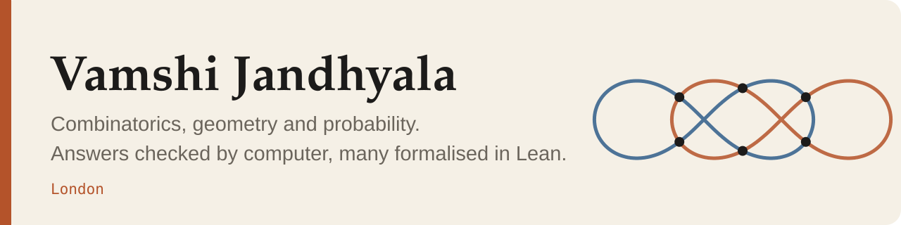

I work on problems in combinatorics, geometry and probability, many of them posed by others on MathOverflow and Mathematics Stack Exchange. Answers come with the code that checks them, and many are formalised in Lean. Every paper is in [mathematics](https://github.com/jvvk/mathematics).

### Open problems settled, formally verified

Each result is checked end to end in Lean 4.

<table>
<tr>
<td width="50%" valign="top">
<a href="https://github.com/jvvk/mathematics/tree/main/almost-square-tilings">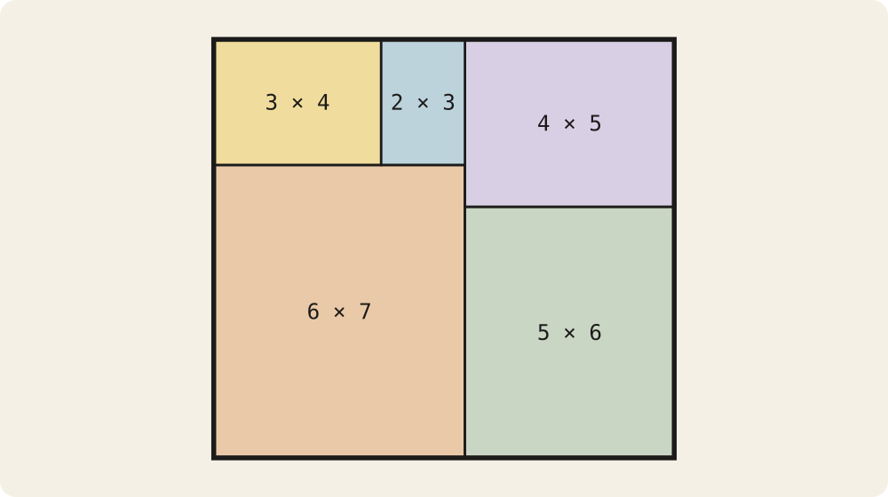</a>

<b><a href="https://github.com/jvvk/mathematics/tree/main/almost-square-tilings">Almost-squares in almost-squares</a></b> 
Which k × (k+1) rectangles split into smaller distinct ones: exactly 4, 10, 12, 14, 15, 18 and every k ≥ 20. Friedman's conjecture. 
<a href="https://github.com/jvvk/mathematics/tree/main/almost-square-tilings/paper">paper</a> · <a href="https://github.com/jvvk/mathematics/tree/main/almost-square-tilings/lean">Lean</a> · <a href="https://github.com/jvvk/mathematics/tree/main/almost-square-tilings/verify">code</a>

</td>
<td width="50%" valign="top">
<a href="https://github.com/jvvk/mathematics/tree/main/two-triangulations-hull">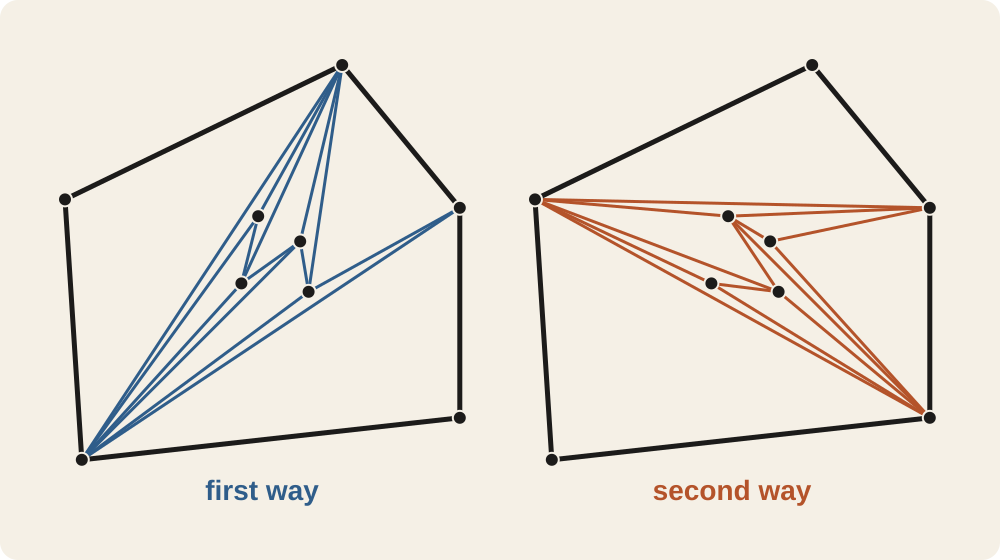</a>

<b><a href="https://github.com/jvvk/mathematics/tree/main/two-triangulations-hull">Two triangulations, one outline</a></b> 
From nine points on, two triangulations can share nothing but the five outline edges, answering Rote. 
<a href="https://github.com/jvvk/mathematics/tree/main/two-triangulations-hull/paper">paper</a> · <a href="https://github.com/jvvk/mathematics/tree/main/two-triangulations-hull/lean">Lean</a> · <a href="https://github.com/jvvk/mathematics/tree/main/two-triangulations-hull/verify">code</a>

</td>
</tr>
<tr>
<td width="50%" valign="top">
<a href="https://github.com/jvvk/mathematics/tree/main/smallest-enclosing-copy">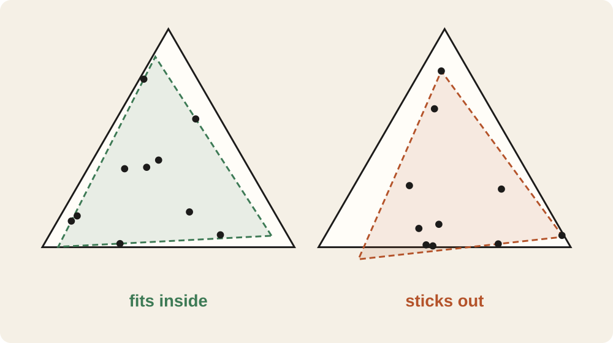</a>

<b><a href="https://github.com/jvvk/mathematics/tree/main/smallest-enclosing-copy">Does the smallest copy fit?</a></b> 
For many random points in an equilateral triangle, the smallest enclosing copy fits inside with probability tending to 13/48, not 1/2. 
<a href="https://github.com/jvvk/mathematics/tree/main/smallest-enclosing-copy/paper">paper</a> · <a href="https://github.com/jvvk/mathematics/tree/main/smallest-enclosing-copy/lean">Lean</a> · <a href="https://github.com/jvvk/mathematics/tree/main/smallest-enclosing-copy/verify">code</a>

</td>
<td width="50%" valign="top">
<a href="https://github.com/jvvk/mathematics/tree/main/random-chords-two-circles">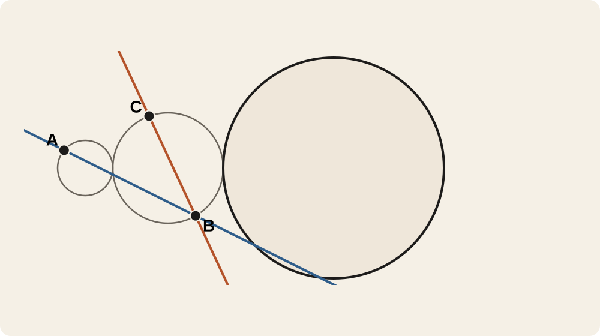</a>

<b><a href="https://github.com/jvvk/mathematics/tree/main/random-chords-two-circles">Random lines past three circles</a></b> 
Lines AB and BC hit the third circle equally often, for every ratio of radii in geometric progression. 
<a href="https://github.com/jvvk/mathematics/tree/main/random-chords-two-circles/paper">paper</a> · <a href="https://github.com/jvvk/mathematics/tree/main/random-chords-two-circles/lean">Lean</a> · <a href="https://github.com/jvvk/mathematics/tree/main/random-chords-two-circles/verify">code</a>

</td>
</tr>
<tr>
<td width="50%" valign="top">
<a href="https://github.com/jvvk/mathematics/tree/main/hamiltonian-cubic-graph">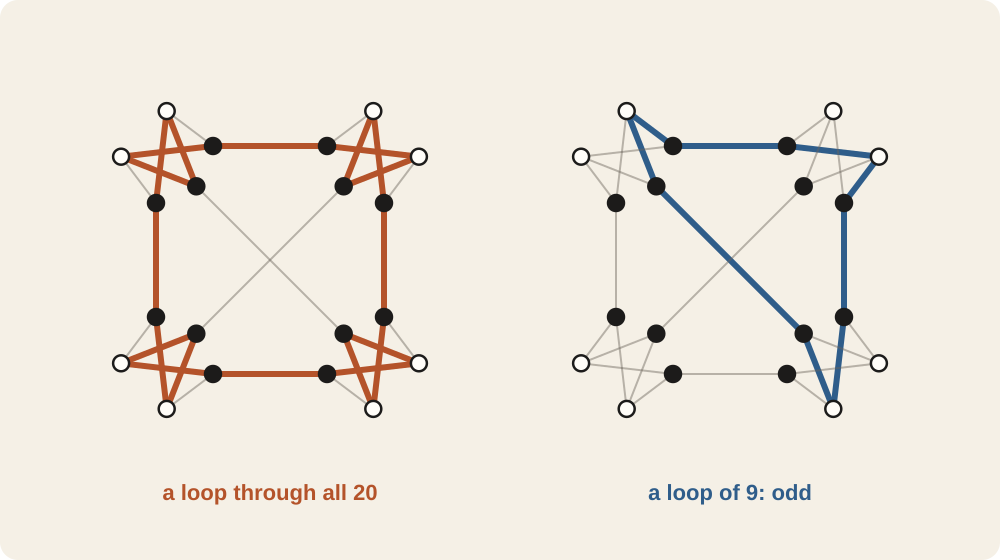</a>

<b><a href="https://github.com/jvvk/mathematics/tree/main/hamiltonian-cubic-graph">A cubic graph with no (n−1)-cycle</a></b> 
Hamiltonian, not bipartite, and no cycle of length 19: an answer to Gordon Royle's question. 
<a href="https://github.com/jvvk/mathematics/tree/main/hamiltonian-cubic-graph/paper">paper</a> · <a href="https://github.com/jvvk/mathematics/tree/main/hamiltonian-cubic-graph/lean">Lean</a> · <a href="https://github.com/jvvk/mathematics/tree/main/hamiltonian-cubic-graph/verify">code</a>

</td>
<td width="50%" valign="top">
<a href="https://github.com/jvvk/mathematics/tree/main/shuffle-anti-squares">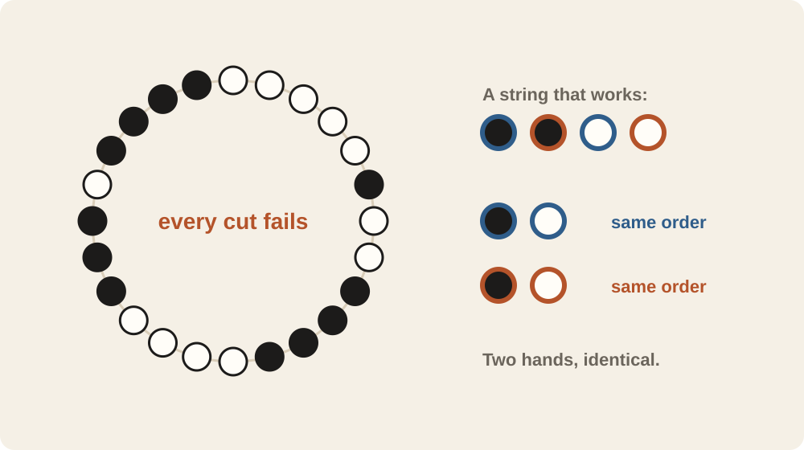</a>

<b><a href="https://github.com/jvvk/mathematics/tree/main/shuffle-anti-squares">Necklaces no cut can split</a></b> 
Shuffle anti-squares exist in every even length from 24, as Grytczuk, Pawlik and Pleszczyński conjectured. 
<a href="https://github.com/jvvk/mathematics/tree/main/shuffle-anti-squares/paper">paper</a> · <a href="https://github.com/jvvk/mathematics/tree/main/shuffle-anti-squares/lean">Lean</a> · <a href="https://github.com/jvvk/mathematics/tree/main/shuffle-anti-squares/verify">code</a>

</td>
</tr>
<tr>
<td width="50%" valign="top">
<a href="https://github.com/jvvk/mathematics/tree/main/mex-sequence-not-periodic">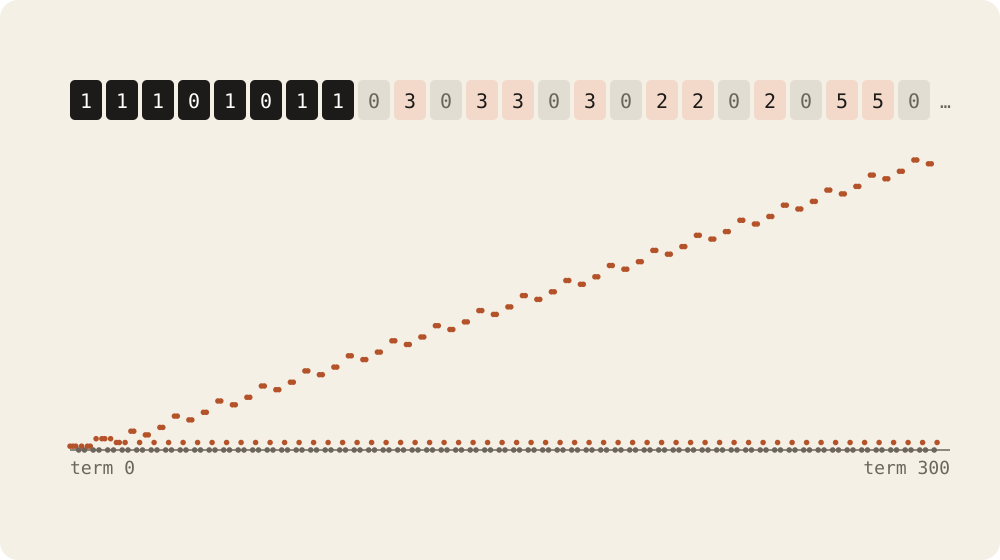</a>

<b><a href="https://github.com/jvvk/mathematics/tree/main/mex-sequence-not-periodic">A mex sequence that never repeats</a></b> 
Guy's question E27: the sequence from 1,1,1,0,1,0,1,1 is unbounded, so not ultimately periodic. 
<a href="https://github.com/jvvk/mathematics/tree/main/mex-sequence-not-periodic/paper">paper</a> · <a href="https://github.com/jvvk/mathematics/tree/main/mex-sequence-not-periodic/lean">Lean</a> · <a href="https://github.com/jvvk/mathematics/tree/main/mex-sequence-not-periodic/verify">code</a>

</td>
<td width="50%" valign="top">
<a href="https://github.com/jvvk/mathematics/tree/main/hofstadter-conway-comparison">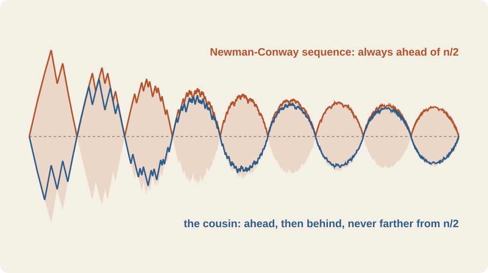</a>

<b><a href="https://github.com/jvvk/mathematics/tree/main/hofstadter-conway-comparison">Newman-Conway and its cousin</a></b> 
Alkan's alternating variant never strays further from n/2 than the Newman-Conway sequence. 
<a href="https://github.com/jvvk/mathematics/tree/main/hofstadter-conway-comparison/paper">paper</a> · <a href="https://github.com/jvvk/mathematics/tree/main/hofstadter-conway-comparison/lean">Lean</a> · <a href="https://github.com/jvvk/mathematics/tree/main/hofstadter-conway-comparison/verify">code</a>

</td>
</tr>
<tr>
<td width="50%" valign="top">
<a href="https://github.com/jvvk/mathematics/tree/main/polynomial-lemniscates">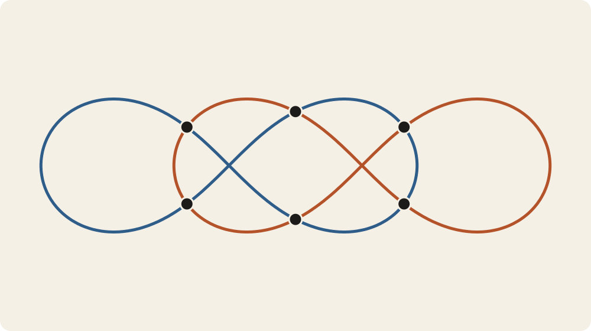</a>

<b><a href="https://github.com/jvvk/mathematics/tree/main/polynomial-lemniscates">Two figures of eight</a></b> 
Polynomial lemniscates meet in at most 2n₁n₂ − 2 points; two lemniscates of Bernoulli in at most six. 
<a href="https://github.com/jvvk/mathematics/tree/main/polynomial-lemniscates/paper">paper</a> · <a href="https://github.com/jvvk/mathematics/tree/main/polynomial-lemniscates/lean">Lean</a> · <a href="https://github.com/jvvk/mathematics/tree/main/polynomial-lemniscates/verify">code</a>

</td>
<td width="50%" valign="top">
<a href="https://github.com/jvvk/mathematics/tree/main/balanced-ternary-quotients">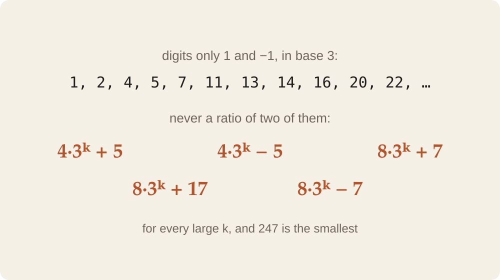</a>

<b><a href="https://github.com/jvvk/mathematics/tree/main/balanced-ternary-quotients">Quotients of balanced ternary numbers</a></b> 
Guy's question F31: infinitely many integers are not a ratio of two numbers whose balanced-ternary digits are all 1 or −1. 
<a href="https://github.com/jvvk/mathematics/tree/main/balanced-ternary-quotients/paper">paper</a> · <a href="https://github.com/jvvk/mathematics/tree/main/balanced-ternary-quotients/lean">Lean</a> · <a href="https://github.com/jvvk/mathematics/tree/main/balanced-ternary-quotients/verify">code</a>

</td>
</tr>
<tr>
<td width="50%" valign="top">
<a href="https://github.com/jvvk/mathematics/tree/main/descent-sets-inverse">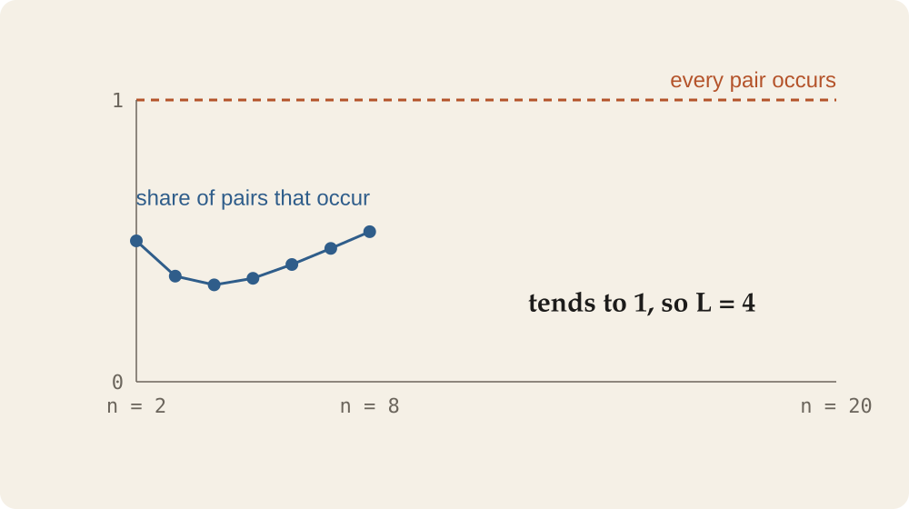</a>

<b><a href="https://github.com/jvvk/mathematics/tree/main/descent-sets-inverse">Descent sets of a permutation and its inverse</a></b> 
Almost every pair of subsets occurs, so Stanley's growth rate is L = 4. 
<a href="https://github.com/jvvk/mathematics/tree/main/descent-sets-inverse/paper">paper</a> · <a href="https://github.com/jvvk/mathematics/tree/main/descent-sets-inverse/lean">Lean</a> · <a href="https://github.com/jvvk/mathematics/tree/main/descent-sets-inverse/verify">code</a>

</td>
<td width="50%" valign="top">
<a href="https://github.com/jvvk/mathematics/tree/main/alternating-sum-positivity">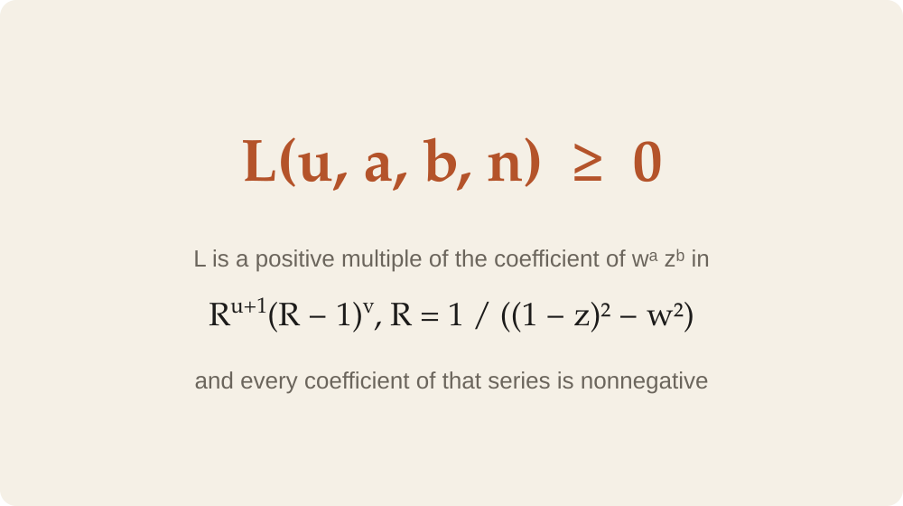</a>

<b><a href="https://github.com/jvvk/mathematics/tree/main/alternating-sum-positivity">An alternating sum that is never negative</a></b> 
Abdesselam's sum L(u,a,b,n) is nonnegative, and Taylor's and Hucht's conjectures follow. 
<a href="https://github.com/jvvk/mathematics/tree/main/alternating-sum-positivity/paper">paper</a> · <a href="https://github.com/jvvk/mathematics/tree/main/alternating-sum-positivity/lean">Lean</a> · <a href="https://github.com/jvvk/mathematics/tree/main/alternating-sum-positivity/verify">code</a>

</td>
</tr>
<tr>
<td width="50%" valign="top">
<a href="https://github.com/jvvk/mathematics/tree/main/symmetric-polynomial-ratio">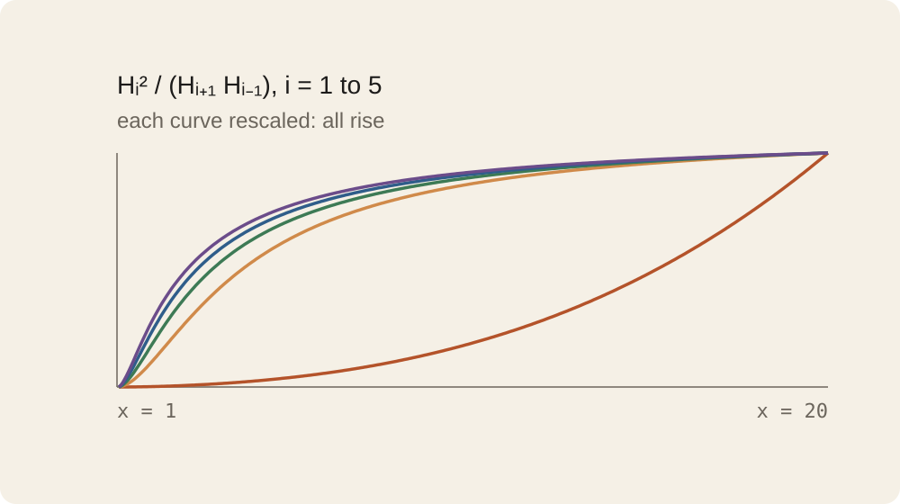</a>

<b><a href="https://github.com/jvvk/mathematics/tree/main/symmetric-polynomial-ratio">A ratio of symmetric polynomials</a></b> 
Ait-Haddou's ratio of complete homogeneous symmetric polynomials increases, for every degree and position. 
<a href="https://github.com/jvvk/mathematics/tree/main/symmetric-polynomial-ratio/paper">paper</a> · <a href="https://github.com/jvvk/mathematics/tree/main/symmetric-polynomial-ratio/lean">Lean</a> · <a href="https://github.com/jvvk/mathematics/tree/main/symmetric-polynomial-ratio/verify">code</a>

</td>
<td width="50%" valign="top">
<a href="https://github.com/jvvk/mathematics/tree/main/even-and-odd-dyck-paths">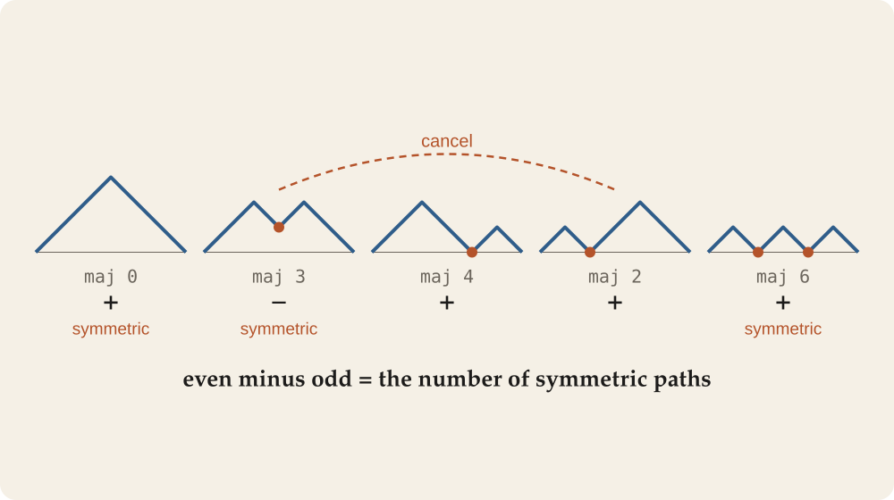</a>

<b><a href="https://github.com/jvvk/mathematics/tree/main/even-and-odd-dyck-paths">Even and odd Dyck paths</a></b> 
Weight a Dyck path by its valley positions: even minus odd is the number of symmetric paths. Cigler's question, a combinatorial proof. 
<a href="https://github.com/jvvk/mathematics/tree/main/even-and-odd-dyck-paths/paper">paper</a> · <a href="https://github.com/jvvk/mathematics/tree/main/even-and-odd-dyck-paths/lean">Lean</a> · <a href="https://github.com/jvvk/mathematics/tree/main/even-and-odd-dyck-paths/verify">code</a>

</td>
</tr>
<tr>
<td width="50%" valign="top">
<a href="https://github.com/jvvk/mathematics/tree/main/sylow-cycle-polynomials">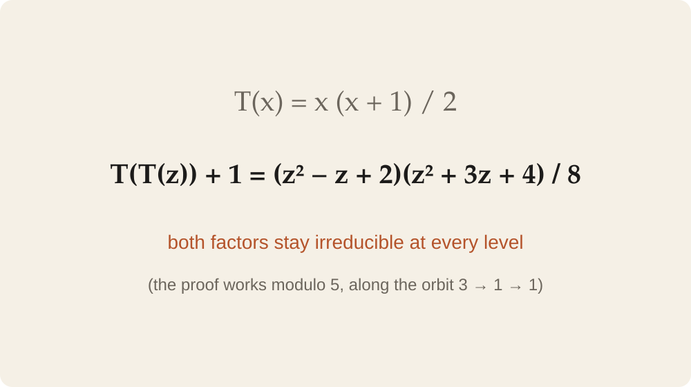</a>

<b><a href="https://github.com/jvvk/mathematics/tree/main/sylow-cycle-polynomials">Counting cycles in a Sylow 2-subgroup</a></b> 
The two factors Stanley observed are irreducible over the rationals at every level. 
<a href="https://github.com/jvvk/mathematics/tree/main/sylow-cycle-polynomials/paper">paper</a> · <a href="https://github.com/jvvk/mathematics/tree/main/sylow-cycle-polynomials/lean">Lean</a> · <a href="https://github.com/jvvk/mathematics/tree/main/sylow-cycle-polynomials/verify">code</a>

</td>
<td width="50%" valign="top">
<a href="https://github.com/jvvk/mathematics/tree/main/half-window-sequence">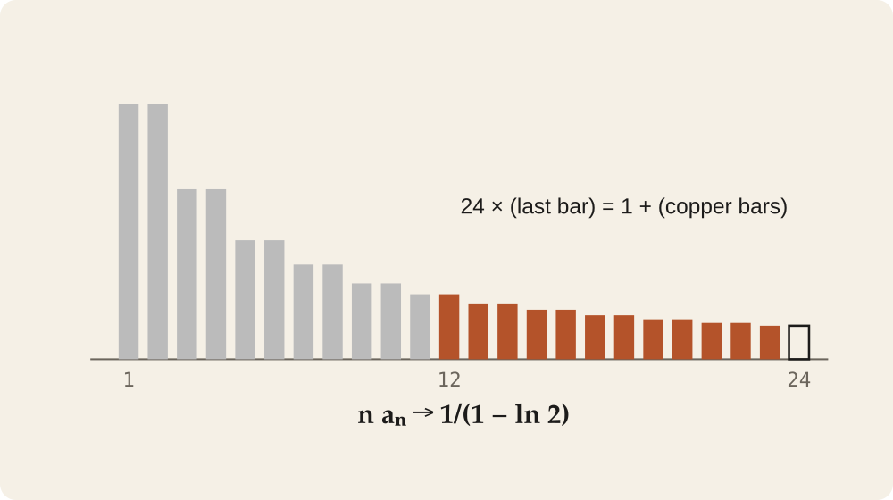</a>

<b><a href="https://github.com/jvvk/mathematics/tree/main/half-window-sequence">A sequence that looks back half way</a></b> 
If a(n) drops by a(⌊n/2⌋)/n at each odd step, then n a(n) tends to 1/(1 − ln 2), as a commenter guessed from the digits. 
<a href="https://github.com/jvvk/mathematics/tree/main/half-window-sequence/paper">paper</a> · <a href="https://github.com/jvvk/mathematics/tree/main/half-window-sequence/lean">Lean</a> · <a href="https://github.com/jvvk/mathematics/tree/main/half-window-sequence/verify">code</a>

</td>
</tr>
</table>

### Open problems settled, verified by computation

Proved by exhaustive search with independent cross-checks, or by hand with parts in Lean.

<table>
<tr>
<td width="50%" valign="top">
<a href="https://github.com/jvvk/mathematics/tree/main/equal-perimeter-rectangles">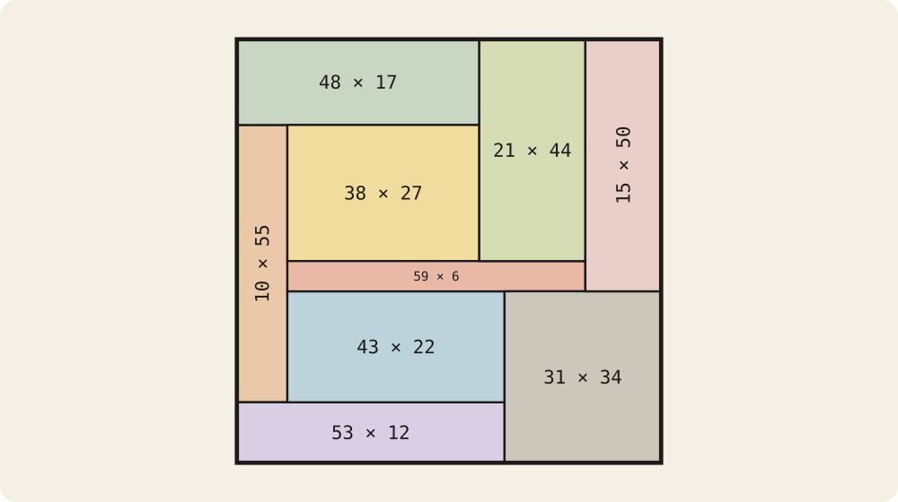</a>

<b><a href="https://github.com/jvvk/mathematics/tree/main/equal-perimeter-rectangles">Equal perimeters, no two alike</a></b> 
A square splits into nine rectangles of equal perimeter, no two congruent; nine is the fewest, with exactly five solutions. 
<a href="https://github.com/jvvk/mathematics/tree/main/equal-perimeter-rectangles/paper">paper</a> · <a href="https://github.com/jvvk/mathematics/tree/main/equal-perimeter-rectangles/verify">code</a> · Exhaustive search, two independent programs

</td>
<td width="50%" valign="top">
<a href="https://github.com/jvvk/mathematics/tree/main/squared-rectangle-697x611">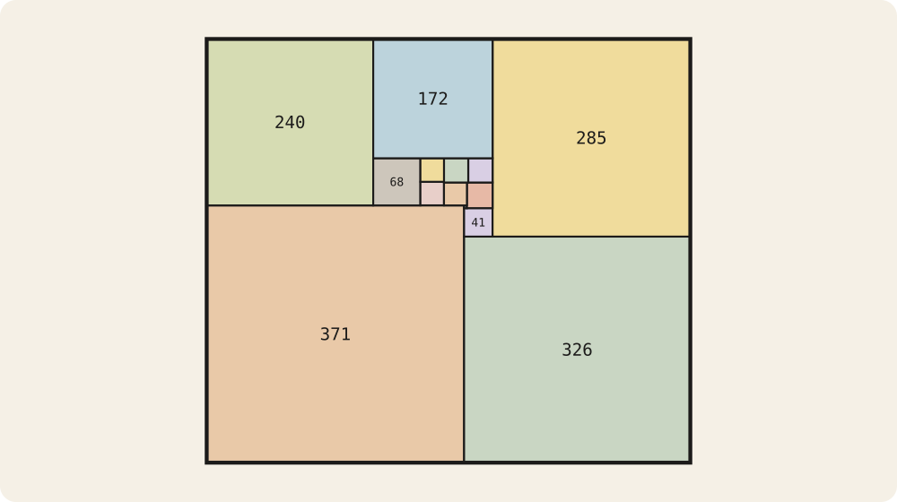</a>

<b><a href="https://github.com/jvvk/mathematics/tree/main/squared-rectangle-697x611">697 × 611 in fourteen squares</a></b> 
The rectangle needs exactly fourteen squares, not seventeen, so it is not a counterexample to the minimal squaring conjecture. 
<a href="https://github.com/jvvk/mathematics/tree/main/squared-rectangle-697x611/paper">paper</a> · <a href="https://github.com/jvvk/mathematics/tree/main/squared-rectangle-697x611/verify">code</a> · Complete enumeration, checked against OEIS

</td>
</tr>
<tr>
<td width="50%" valign="top">
<a href="https://github.com/jvvk/mathematics/tree/main/math-magic-problems">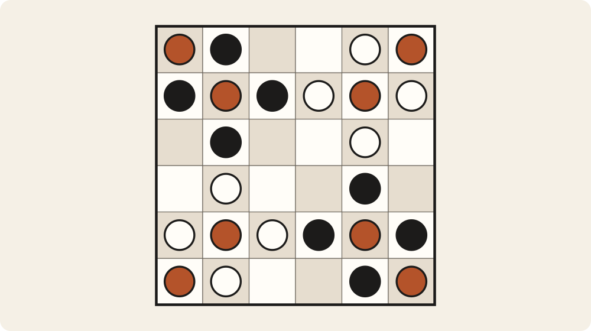</a>

<b><a href="https://github.com/jvvk/mathematics/tree/main/math-magic-problems">Three armies of bishops</a></b> 
Three armies of five bishops fit on a 5 × 5 board and three of eight on 6 × 6, and no more: Friedman's two values. 
<a href="https://github.com/jvvk/mathematics/tree/main/math-magic-problems/paper">paper</a> · <a href="https://github.com/jvvk/mathematics/tree/main/math-magic-problems/verify">code</a> · Exhaustive count of diagonal labellings

</td>
<td width="50%" valign="top">
<a href="https://github.com/jvvk/mathematics/tree/main/math-magic-problems">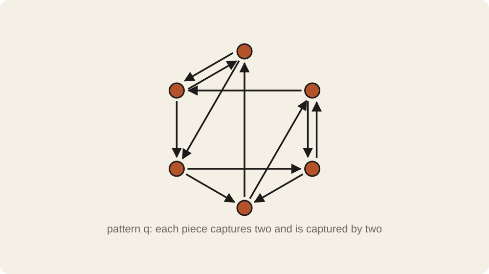</a>

<b><a href="https://github.com/jvvk/mathematics/tree/main/math-magic-problems">Chess capture patterns</a></b> 
Friedman's capture digraphs q, r and s are not made by any chess position, on any board. 
<a href="https://github.com/jvvk/mathematics/tree/main/math-magic-problems/paper">paper</a> · <a href="https://github.com/jvvk/mathematics/tree/main/math-magic-problems/verify">code</a> · Two independent solvers

</td>
</tr>
<tr>
<td width="50%" valign="top">
<a href="https://github.com/jvvk/mathematics/tree/main/math-magic-problems">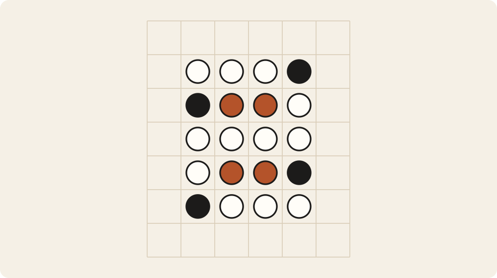</a>

<b><a href="https://github.com/jvvk/mathematics/tree/main/math-magic-problems">Kings that touch in a cycle</a></b> 
Kings with touch counts (1,3,6), (1,6,3) or (2,3,4) admit no finite arrangement: Friedman's unsolved problem 24. 
<a href="https://github.com/jvvk/mathematics/tree/main/math-magic-problems/paper">paper</a> · <a href="https://github.com/jvvk/mathematics/tree/main/math-magic-problems/verify">code</a> · DRUP certificates, independent Z3 check

</td>
<td width="50%" valign="top">
<a href="https://github.com/jvvk/mathematics/tree/main/math-magic-problems">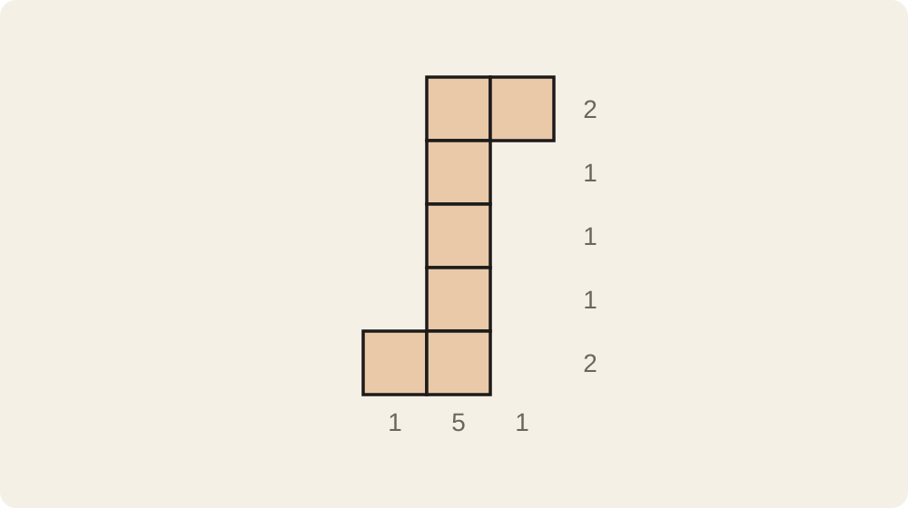</a>

<b><a href="https://github.com/jvvk/mathematics/tree/main/math-magic-problems">A heptomino that never balances</a></b> 
This heptomino never fills a square with equal row and column counts, in any size: one shape of Friedman's problem 15. 
<a href="https://github.com/jvvk/mathematics/tree/main/math-magic-problems/paper">paper</a> · <a href="https://github.com/jvvk/mathematics/tree/main/math-magic-problems/verify">code</a> · Proof by hand, exact checker

</td>
</tr>
<tr>
<td width="50%" valign="top">
<a href="https://github.com/jvvk/mathematics/tree/main/math-magic-problems">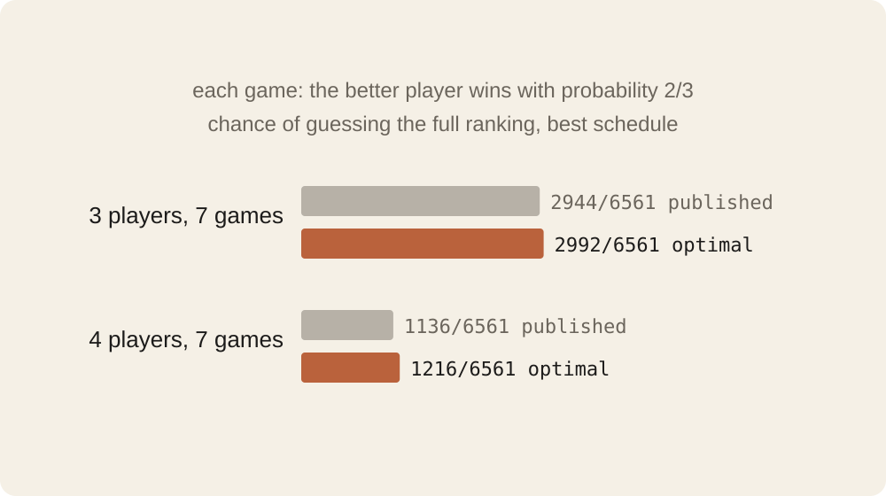</a>

<b><a href="https://github.com/jvvk/mathematics/tree/main/math-magic-problems">A tournament schedule that beats the table</a></b> 
Friedman's optimal tournaments: exact best schedules over all adaptive plans, two of them better than the published values. 
<a href="https://github.com/jvvk/mathematics/tree/main/math-magic-problems/paper">paper</a> · <a href="https://github.com/jvvk/mathematics/tree/main/math-magic-problems/verify">code</a> · Exact recursion, two programs

</td>
<td width="50%" valign="top">
<a href="https://github.com/jvvk/mathematics/tree/main/math-magic-problems">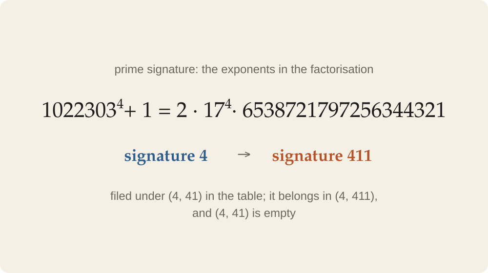</a>

<b><a href="https://github.com/jvvk/mathematics/tree/main/math-magic-problems">A misfiled prime signature</a></b> 
In Friedman's prime-signature table, 1022303⁴ belongs in cell (4, 411), where it is the smallest; cell (4, 41) is empty. 
<a href="https://github.com/jvvk/mathematics/tree/main/math-magic-problems/paper">paper</a> · <a href="https://github.com/jvvk/mathematics/tree/main/math-magic-problems/verify">code</a> · Proof by hand, computer search

</td>
</tr>
<tr>
<td width="50%" valign="top">
<a href="https://github.com/jvvk/mathematics/tree/main/powers-of-four-representations">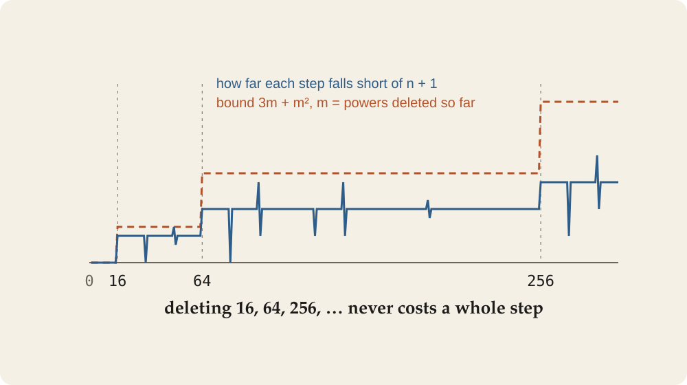</a>

<b><a href="https://github.com/jvvk/mathematics/tree/main/powers-of-four-representations">Deleting the powers of four</a></b> 
Remove 16, 64, 256, … and the ordered ways to write n as a sum of three survivors still rise at every n: Sándor and Yang's Remark 1.3. 
<a href="https://github.com/jvvk/mathematics/tree/main/powers-of-four-representations/paper">paper</a> · <a href="https://github.com/jvvk/mathematics/tree/main/powers-of-four-representations/lean">Lean</a> · <a href="https://github.com/jvvk/mathematics/tree/main/powers-of-four-representations/verify">code</a> · Proposition 1 in Lean; Problem 1.4 facts by hand

</td>
<td width="50%" valign="top">
<a href="https://github.com/jvvk/mathematics/tree/main/tangent-circles-incentre">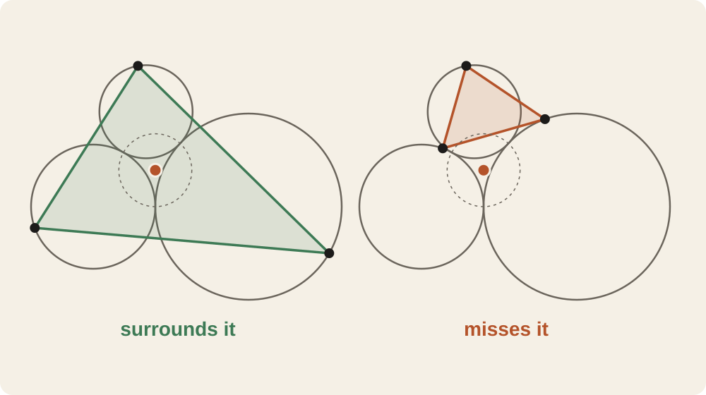</a>

<b><a href="https://github.com/jvvk/mathematics/tree/main/tangent-circles-incentre">Three circles and a fair coin</a></b> 
A triangle through random points on three touching circles contains the incentre with probability exactly 1/2, for all radii. 
<a href="https://github.com/jvvk/mathematics/tree/main/tangent-circles-incentre/paper">paper</a> · <a href="https://github.com/jvvk/mathematics/tree/main/tangent-circles-incentre/lean">Lean</a> · <a href="https://github.com/jvvk/mathematics/tree/main/tangent-circles-incentre/verify">code</a> · Partly in Lean; geometry by hand

</td>
</tr>
<tr>
<td width="50%" valign="top">
<a href="https://github.com/jvvk/mathematics/tree/main/zero-sum-selection-game">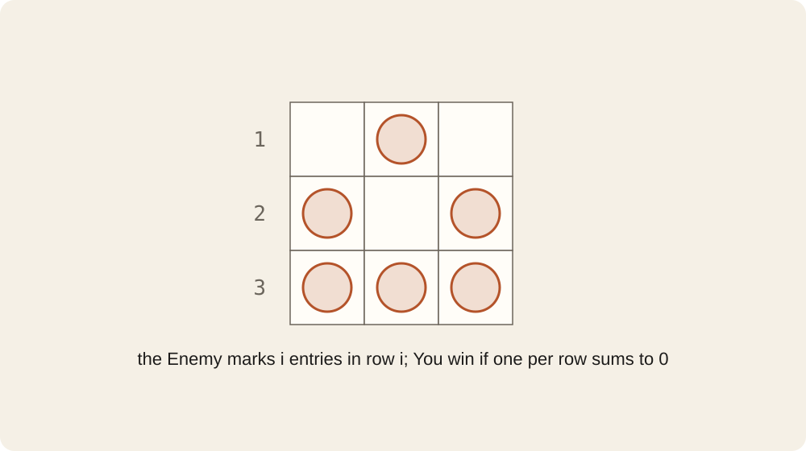</a>

<b><a href="https://github.com/jvvk/mathematics/tree/main/zero-sum-selection-game">A zero-sum selection game</a></b> 
Lev's question: the winning matrices form a union of subspaces of dimension n(n+1)/2 − 1, and recognising them is Π₂ᵖ-complete. 
<a href="https://github.com/jvvk/mathematics/tree/main/zero-sum-selection-game/paper">paper</a> · <a href="https://github.com/jvvk/mathematics/tree/main/zero-sum-selection-game/lean">Lean</a> · <a href="https://github.com/jvvk/mathematics/tree/main/zero-sum-selection-game/verify">code</a> · Partly in Lean; reduction by hand

</td>
<td width="50%"></td>
</tr>
</table>

### Partial progress

Part of the question answered; the rest is still open.

<table>
<tr>
<td width="50%" valign="top">
<a href="https://github.com/jvvk/mathematics/tree/main/latin-squares-small-rank">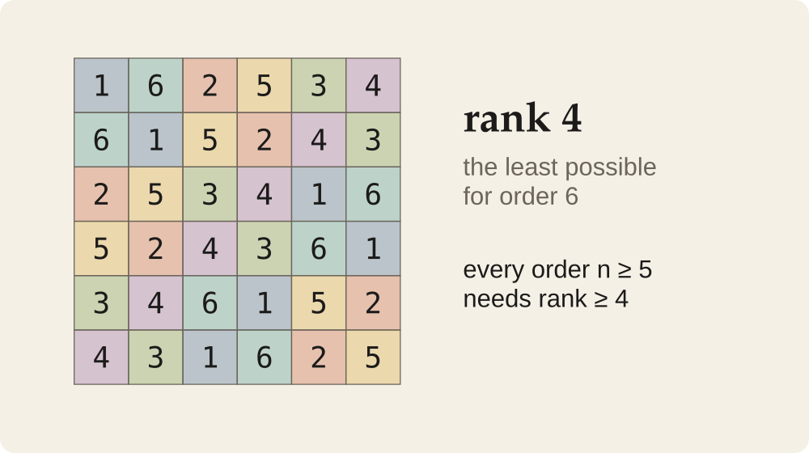</a>

<b><a href="https://github.com/jvvk/mathematics/tree/main/latin-squares-small-rank">Latin squares of small rank</a></b> 
Every Latin square of order n has rank at least 1 + 3(n−1)/(n+1), so at least 4 from n = 5 on; the least ranks up to order 8 are 1, 2, 3, 3, 5, 4, 6, 4. 
<a href="https://github.com/jvvk/mathematics/tree/main/latin-squares-small-rank/paper">paper</a> · <a href="https://github.com/jvvk/mathematics/tree/main/latin-squares-small-rank/lean">Lean</a> · <a href="https://github.com/jvvk/mathematics/tree/main/latin-squares-small-rank/verify">code</a> · Bound and r(6), r(8) in Lean; r(5), r(7) by exact search

</td>
<td width="50%" valign="top">
<a href="https://github.com/jvvk/mathematics/tree/main/good-permutations-mersenne">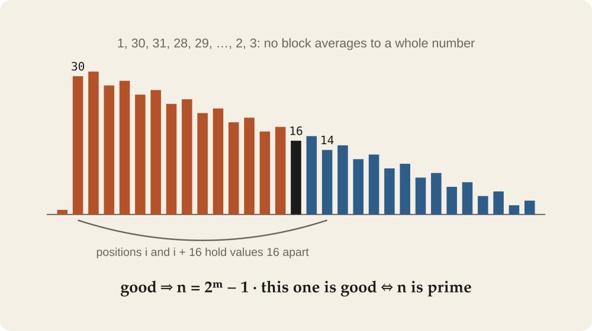</a>

<b><a href="https://github.com/jvvk/mathematics/tree/main/good-permutations-mersenne">Permutations with no whole-number averages</a></b> 
If no proper block of a permutation of 1..n averages to a whole number, then n = 2ᵐ − 1; the asker's example works exactly when n is prime, and n = 15, 63 have none. 
<a href="https://github.com/jvvk/mathematics/tree/main/good-permutations-mersenne/paper">paper</a> · <a href="https://github.com/jvvk/mathematics/tree/main/good-permutations-mersenne/lean">Lean</a> · <a href="https://github.com/jvvk/mathematics/tree/main/good-permutations-mersenne/verify">code</a> · Theorems in Lean; n ≤ 63 by two searches

</td>
</tr>
<tr>
<td width="50%" valign="top">
<a href="https://github.com/jvvk/mathematics/tree/main/catching-the-centroid">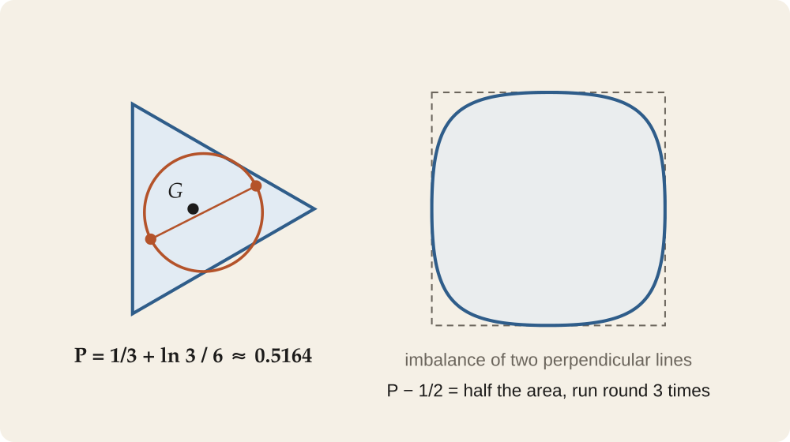</a>

<b><a href="https://github.com/jvvk/mathematics/tree/main/catching-the-centroid">Catching the centroid</a></b> 
A circle on a random diameter of a convex region contains the centroid with probability at most 14/27 ≈ 0.5185; the equilateral triangle's 0.5164 is conjectured best. 
<a href="https://github.com/jvvk/mathematics/tree/main/catching-the-centroid/paper">paper</a> · <a href="https://github.com/jvvk/mathematics/tree/main/catching-the-centroid/lean">Lean</a> · <a href="https://github.com/jvvk/mathematics/tree/main/catching-the-centroid/verify">code</a> · Bounds in Lean; sharp value open

</td>
<td width="50%" valign="top">
<a href="https://github.com/jvvk/mathematics/tree/main/broken-stick-feynman">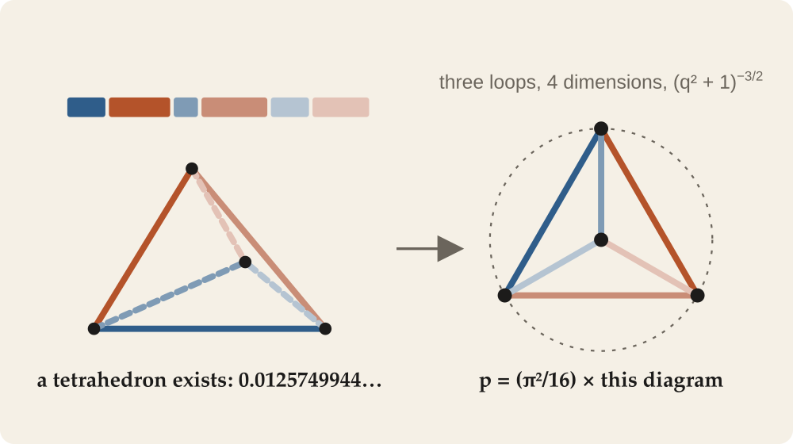</a>

<b><a href="https://github.com/jvvk/mathematics/tree/main/broken-stick-feynman">A broken stick and a Feynman diagram</a></b> 
The chance that six random pieces of a stick make a tetrahedron is a three-loop Feynman diagram; it is 0.0125749944…, not 1/79. 
<a href="https://github.com/jvvk/mathematics/tree/main/broken-stick-feynman/paper">paper</a> · <a href="https://github.com/jvvk/mathematics/tree/main/broken-stick-feynman/lean">Lean</a> · <a href="https://github.com/jvvk/mathematics/tree/main/broken-stick-feynman/verify">code</a> · Algebra in Lean; no closed form

</td>
</tr>
<tr>
<td width="50%" valign="top">
<a href="https://github.com/jvvk/mathematics/tree/main/prime-squares-half-turns">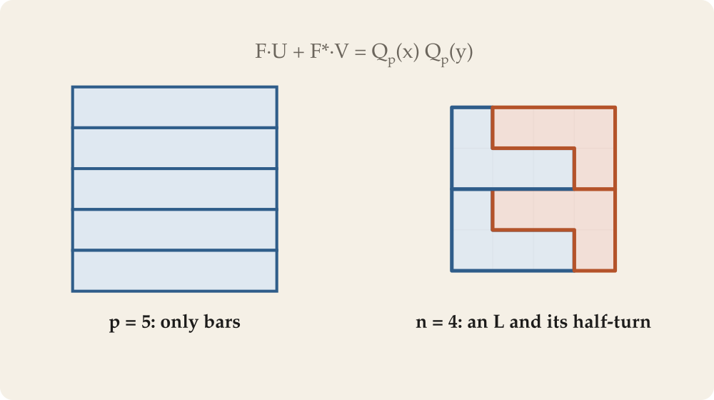</a>

<b><a href="https://github.com/jvvk/mathematics/tree/main/prime-squares-half-turns">Prime squares and half-turns</a></b> 
A p × p square, p prime, cut into p congruent pieces that are only translated or half-turned must be cut into bars; with quarter-turns too, the question is open. 
<a href="https://github.com/jvvk/mathematics/tree/main/prime-squares-half-turns/paper">paper</a> · <a href="https://github.com/jvvk/mathematics/tree/main/prime-squares-half-turns/lean">Lean</a> · <a href="https://github.com/jvvk/mathematics/tree/main/prime-squares-half-turns/verify">code</a> · Algebra in Lean; full question open

</td>
<td width="50%" valign="top">
<a href="https://github.com/jvvk/mathematics/tree/main/five-numbers-many-averages">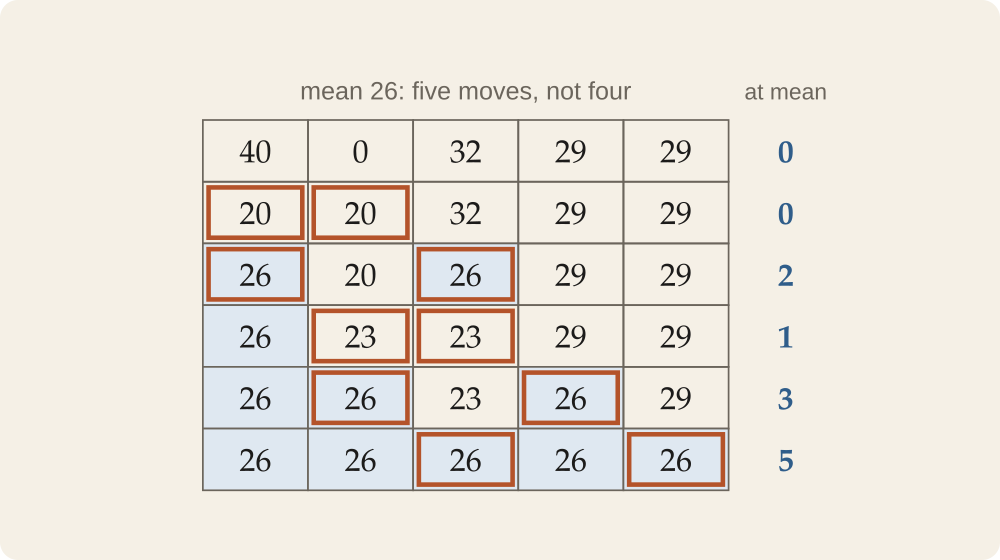</a>

<b><a href="https://github.com/jvvk/mathematics/tree/main/five-numbers-many-averages">Five numbers, many averages</a></b> 
Replacing two numbers by their average, the five integers (5N, 0, 4N, 3N±5, 3N±5) with N = 2ᵏ⁺¹ need exactly k + 3 moves to become equal, so five numbers have no bound on the shortest solution. 
<a href="https://github.com/jvvk/mathematics/tree/main/five-numbers-many-averages/paper">paper</a> · <a href="https://github.com/jvvk/mathematics/tree/main/five-numbers-many-averages/lean">Lean</a> · <a href="https://github.com/jvvk/mathematics/tree/main/five-numbers-many-averages/verify">code</a> · In Lean; which lists are solvable is open

</td>
</tr>
<tr>
<td width="50%" valign="top">
<a href="https://github.com/jvvk/mathematics/tree/main/why-the-sphere-beats-the-ball">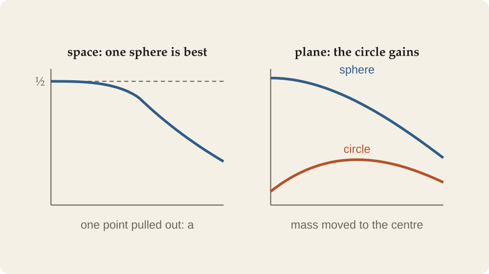</a>

<b><a href="https://github.com/jvvk/mathematics/tree/main/why-the-sphere-beats-the-ball">Why the sphere beats the ball</a></b> 
Three points on concentric spheres form an acute triangle with probability at most 1/2, equal only when the two outer radii agree; so the uniform sphere beats every rotationally invariant law in space, while in the plane moving mass inwards helps. 
<a href="https://github.com/jvvk/mathematics/tree/main/why-the-sphere-beats-the-ball/paper">paper</a> · <a href="https://github.com/jvvk/mathematics/tree/main/why-the-sphere-beats-the-ball/lean">Lean</a> · <a href="https://github.com/jvvk/mathematics/tree/main/why-the-sphere-beats-the-ball/verify">code</a> · Formula and bound in Lean; the disc's gain unexplained

</td>
<td width="50%" valign="top">
<a href="https://github.com/jvvk/mathematics/tree/main/raising-the-apex">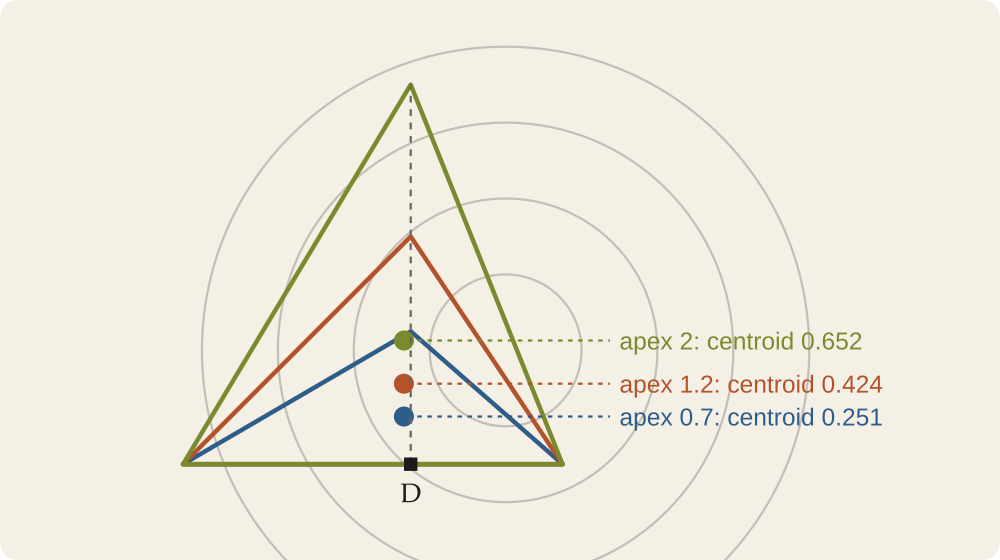</a>

<b><a href="https://github.com/jvvk/mathematics/tree/main/raising-the-apex">Raising the apex raises the Gaussian centroid</a></b> 
Raise a triangle's apex along the perpendicular through a point of its base and the Gaussian centre of mass rises, in every dimension and wherever the Gaussian is centred; whether it always pins down the moving vertex is open. 
<a href="https://github.com/jvvk/mathematics/tree/main/raising-the-apex/paper">paper</a> · <a href="https://github.com/jvvk/mathematics/tree/main/raising-the-apex/lean">Lean</a> · <a href="https://github.com/jvvk/mathematics/tree/main/raising-the-apex/verify">code</a> · Steps after Prékopa's theorem in Lean; oblique case open

</td>
</tr>
<tr>
<td width="50%" valign="top">
<a href="https://github.com/jvvk/mathematics/tree/main/unit-hexagon-diameter">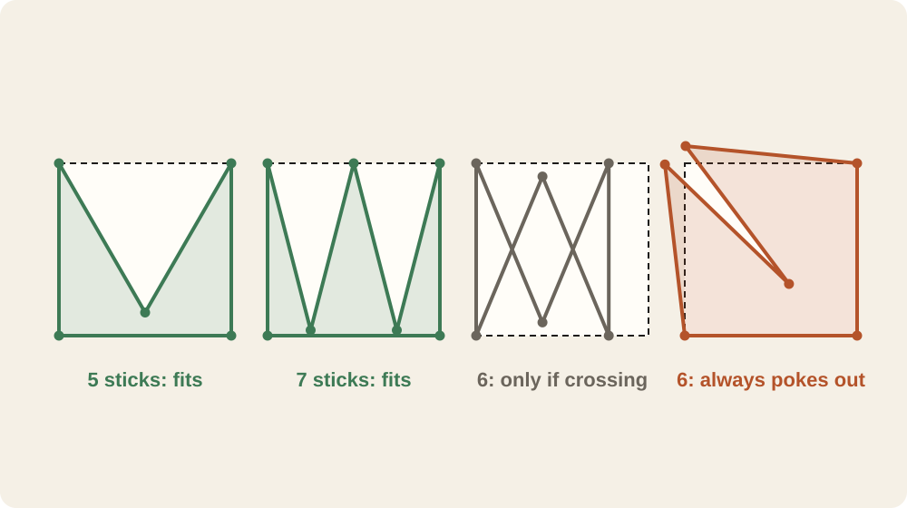</a>

<b><a href="https://github.com/jvvk/mathematics/tree/main/unit-hexagon-diameter">Six matchsticks in a square</a></b> 
No simple loop of six unit sticks fits in a unit square: the six-stick case of an open parity question. 
<a href="https://github.com/jvvk/mathematics/tree/main/unit-hexagon-diameter/paper">paper</a> · <a href="https://github.com/jvvk/mathematics/tree/main/unit-hexagon-diameter/lean">Lean</a> · <a href="https://github.com/jvvk/mathematics/tree/main/unit-hexagon-diameter/verify">code</a> · Partly in Lean

</td>
<td width="50%" valign="top">
<a href="https://github.com/jvvk/mathematics/tree/main/randomized-pascal-triangle">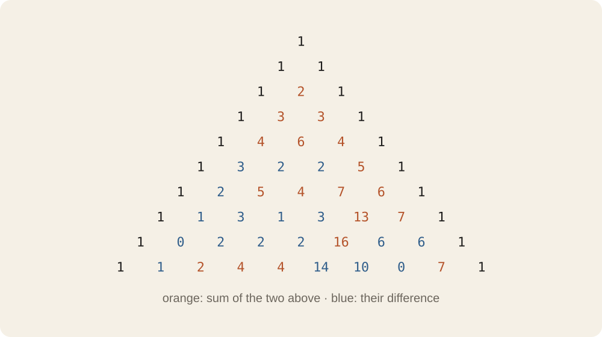</a>

<b><a href="https://github.com/jvvk/mathematics/tree/main/randomized-pascal-triangle">A randomized Pascal triangle</a></b> 
The expected average blows up whenever p ≥ 0.232; whether it does for every p > 0 is open. 
<a href="https://github.com/jvvk/mathematics/tree/main/randomized-pascal-triangle/paper">paper</a> · <a href="https://github.com/jvvk/mathematics/tree/main/randomized-pascal-triangle/lean">Lean</a> · <a href="https://github.com/jvvk/mathematics/tree/main/randomized-pascal-triangle/verify">code</a> · In Lean

</td>
</tr>
<tr>
<td width="50%" valign="top">
<a href="https://github.com/jvvk/mathematics/tree/main/power-two-tree-labels">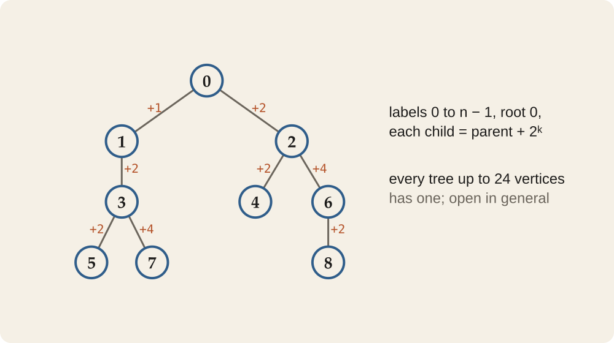</a>

<b><a href="https://github.com/jvvk/mathematics/tree/main/power-two-tree-labels">Labelling binary trees by powers of two</a></b> 
Every tree with at most 24 vertices can be labelled 0 to n − 1 with power-of-two steps; five constructions and an exact rule for universal label sets narrow any counterexample. 
<a href="https://github.com/jvvk/mathematics/tree/main/power-two-tree-labels/paper">paper</a> · <a href="https://github.com/jvvk/mathematics/tree/main/power-two-tree-labels/lean">Lean</a> · <a href="https://github.com/jvvk/mathematics/tree/main/power-two-tree-labels/verify">code</a> · Constructions and lemmas in Lean; searches by two programs

</td>
<td width="50%" valign="top">
<a href="https://github.com/jvvk/mathematics/tree/main/wandering-over-divisors">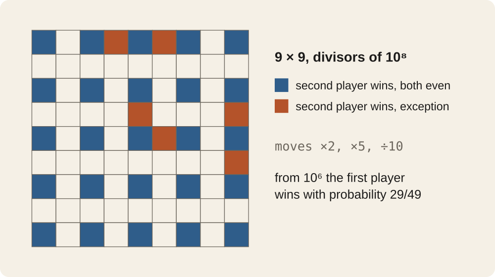</a>

<b><a href="https://github.com/jvvk/mathematics/tree/main/wandering-over-divisors">Wandering over the divisors of 10ⁿ</a></b> 
Players multiply by 2 or 5 or divide by 10, never repeating a divisor. The tournament's natural answer fails from 10⁶ on, and the second player beats whole families of openings on every board. 
<a href="https://github.com/jvvk/mathematics/tree/main/wandering-over-divisors/paper">paper</a> · <a href="https://github.com/jvvk/mathematics/tree/main/wandering-over-divisors/lean">Lean</a> · <a href="https://github.com/jvvk/mathematics/tree/main/wandering-over-divisors/verify">code</a> · Theorems in Lean; tables by two programs

</td>
</tr>
<tr>
<td width="50%" valign="top">
<a href="https://github.com/jvvk/taxicab-distances-eleven">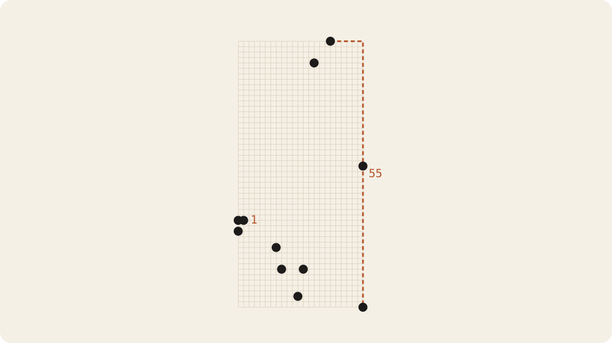</a>

<b><a href="https://github.com/jvvk/taxicab-distances-eleven">Eleven points, distances 1 to 55</a></b> 
Eleven lattice points whose 55 taxicab distances are exactly 1 to 55: the case n = 11 of an open question. 
<a href="https://github.com/jvvk/taxicab-distances-eleven">repository</a> · Computer search

</td>
<td width="50%" valign="top">
<a href="https://github.com/jvvk/mathematics/tree/main/cube-unfoldings-tile-space">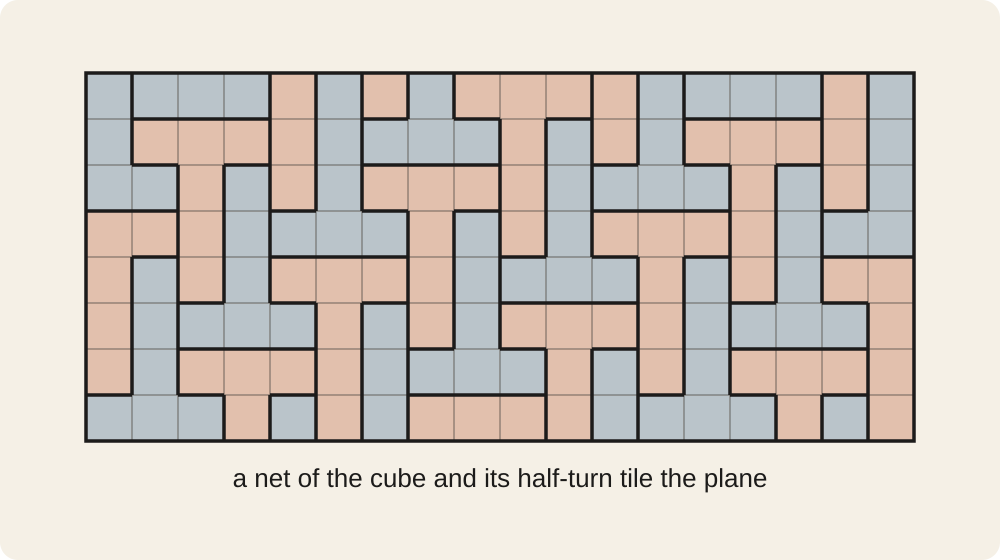</a>

<b><a href="https://github.com/jvvk/mathematics/tree/main/cube-unfoldings-tile-space">Unfolded cubes that tile space</a></b> 
Every one of the 502,110 unfoldings of the six-dimensional cube tiles five-space with its point reflection, extending Firet's five-cube result. 
<a href="https://github.com/jvvk/mathematics/tree/main/cube-unfoldings-tile-space/paper">paper</a> · <a href="https://github.com/jvvk/mathematics/tree/main/cube-unfoldings-tile-space/lean">Lean</a> · <a href="https://github.com/jvvk/mathematics/tree/main/cube-unfoldings-tile-space/verify">code</a> · Certificates, two checkers; lemmas in Lean

</td>
</tr>
<tr>
<td width="50%" valign="top">
<a href="https://github.com/jvvk/mathematics/tree/main/balanced-tree-agreement-subtrees">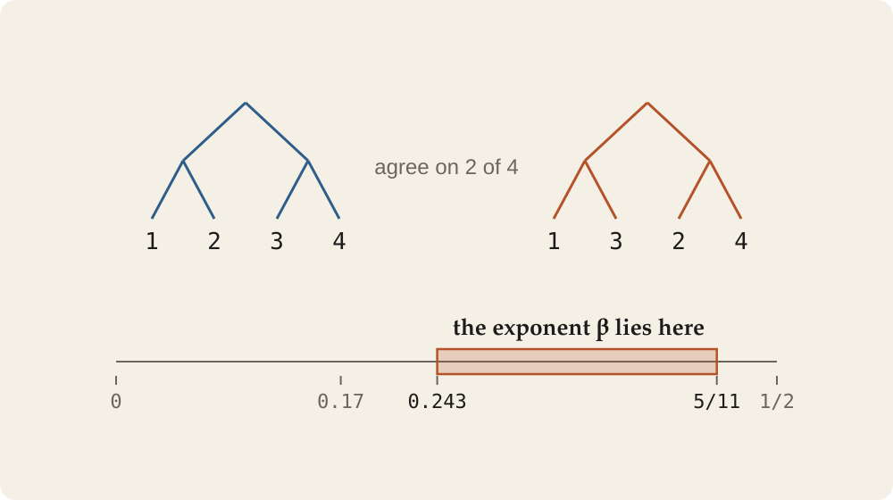</a>

<b><a href="https://github.com/jvvk/mathematics/tree/main/balanced-tree-agreement-subtrees">How much two balanced trees must share</a></b> 
Two balanced trees on n leaves always agree on at least n^0.243 leaves, and some on only n^(5/11); Martin and Thatte conjectured n^(1/2). 
<a href="https://github.com/jvvk/mathematics/tree/main/balanced-tree-agreement-subtrees/paper">paper</a> · <a href="https://github.com/jvvk/mathematics/tree/main/balanced-tree-agreement-subtrees/lean">Lean</a> · <a href="https://github.com/jvvk/mathematics/tree/main/balanced-tree-agreement-subtrees/verify">code</a> · Lean, except one certified inequality

</td>
<td width="50%" valign="top">
<a href="https://github.com/jvvk/mathematics/tree/main/math-magic-problems">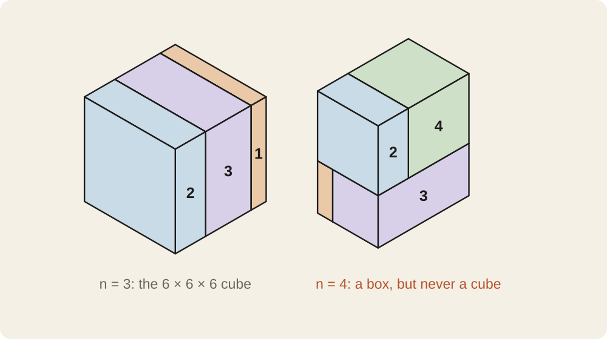</a>

<b><a href="https://github.com/jvvk/mathematics/tree/main/math-magic-problems">Cubes cut into slabs</a></b> 
A cube made of one k-slab for each k ≤ n has side at most n(n+1)/2, and none exists for n = 4, 5, 6; Friedman conjectures infinitely many. 
<a href="https://github.com/jvvk/mathematics/tree/main/math-magic-problems/paper">paper</a> · <a href="https://github.com/jvvk/mathematics/tree/main/math-magic-problems/verify">code</a> · Bound by hand, n = 4 to 6 by two searches

</td>
</tr>
<tr>
<td width="50%" valign="top">
<a href="https://github.com/jvvk/mathematics/tree/main/span-maximising-chains">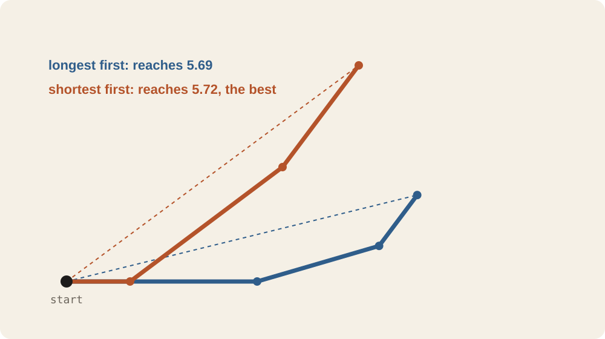</a>

<b><a href="https://github.com/jvvk/mathematics/tree/main/span-maximising-chains">The chain that reaches farthest</a></b> 
Every best chain has lengths rising then falling; exactly three orders occur for four segments, and the general count is open. 
<a href="https://github.com/jvvk/mathematics/tree/main/span-maximising-chains/paper">paper</a> · <a href="https://github.com/jvvk/mathematics/tree/main/span-maximising-chains/lean">Lean</a> · <a href="https://github.com/jvvk/mathematics/tree/main/span-maximising-chains/verify">code</a> · Shape theorem in Lean

</td>
<td width="50%"></td>
</tr>
</table>

### New proofs of known results

<table>
<tr>
<td width="50%" valign="top">
<a href="https://github.com/jvvk/mathematics/tree/main/six-circles-rectangle">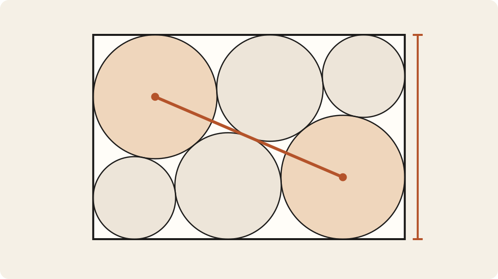</a>

<b><a href="https://github.com/jvvk/mathematics/tree/main/six-circles-rectangle">Six circles in a rectangle</a></b> 
The red segment is exactly as long as the rectangle is tall: a proof by classical geometry alone. 
<a href="https://github.com/jvvk/mathematics/tree/main/six-circles-rectangle/paper">paper</a> · <a href="https://github.com/jvvk/mathematics/tree/main/six-circles-rectangle/lean">Lean</a> · <a href="https://github.com/jvvk/mathematics/tree/main/six-circles-rectangle/verify">code</a> · In Lean, step by step

</td>
<td width="50%"></td>
</tr>
</table>

### Elsewhere

- [Four acute faces](https://mathoverflow.net/a/515661): a random tetrahedron inscribed in a sphere has four acute faces with probability 1/12.

Papers and figures CC BY 4.0, code MIT.
