

I work on problems in combinatorics, geometry and probability, many of them posed by others on MathOverflow and Mathematics Stack Exchange. Answers come with the code that checks them, and many are formalised in Lean. Every paper is in [mathematics](https://github.com/jvvk/mathematics).

### Open problems settled, formally verified

Each result is checked end to end in Lean 4.

<table>
<tr>
<td width="50%" valign="top">

<b><a href="https://github.com/jvvk/mathematics/tree/main/almost-square-tilings">Almost-squares in almost-squares</a></b> 
Which k × (k+1) rectangles split into smaller distinct ones: exactly 4, 10, 12, 14, 15, 18 and every k ≥ 20. Friedman's conjecture. 
<a href="https://github.com/jvvk/mathematics/tree/main/almost-square-tilings/paper">paper</a> · <a href="https://github.com/jvvk/mathematics/tree/main/almost-square-tilings/lean">Lean</a> · <a href="https://github.com/jvvk/mathematics/tree/main/almost-square-tilings/verify">code</a>

</td>
<td width="50%" valign="top">

<b><a href="https://github.com/jvvk/mathematics/tree/main/two-triangulations-hull">Two triangulations, one outline</a></b> 
From nine points on, two triangulations can share nothing but the five outline edges, answering Rote. 
<a href="https://github.com/jvvk/mathematics/tree/main/two-triangulations-hull/paper">paper</a> · <a href="https://github.com/jvvk/mathematics/tree/main/two-triangulations-hull/lean">Lean</a> · <a href="https://github.com/jvvk/mathematics/tree/main/two-triangulations-hull/verify">code</a>

</td>
</tr>
<tr>
<td width="50%" valign="top">

<b><a href="https://github.com/jvvk/mathematics/tree/main/smallest-enclosing-copy">Does the smallest copy fit?</a></b> 
For many random points in an equilateral triangle, the smallest enclosing copy fits inside with probability tending to 13/48, not 1/2. 
<a href="https://github.com/jvvk/mathematics/tree/main/smallest-enclosing-copy/paper">paper</a> · <a href="https://github.com/jvvk/mathematics/tree/main/smallest-enclosing-copy/lean">Lean</a> · <a href="https://github.com/jvvk/mathematics/tree/main/smallest-enclosing-copy/verify">code</a>

</td>
<td width="50%" valign="top">

<b><a href="https://github.com/jvvk/mathematics/tree/main/random-chords-two-circles">Random lines past three circles</a></b> 
Lines AB and BC hit the third circle equally often, for every ratio of radii in geometric progression. 
<a href="https://github.com/jvvk/mathematics/tree/main/random-chords-two-circles/paper">paper</a> · <a href="https://github.com/jvvk/mathematics/tree/main/random-chords-two-circles/lean">Lean</a> · <a href="https://github.com/jvvk/mathematics/tree/main/random-chords-two-circles/verify">code</a>

</td>
</tr>
<tr>
<td width="50%" valign="top">

<b><a href="https://github.com/jvvk/mathematics/tree/main/hamiltonian-cubic-graph">A cubic graph with no (n−1)-cycle</a></b> 
Hamiltonian, not bipartite, and no cycle of length 19: an answer to Gordon Royle's question. 
<a href="https://github.com/jvvk/mathematics/tree/main/hamiltonian-cubic-graph/paper">paper</a> · <a href="https://github.com/jvvk/mathematics/tree/main/hamiltonian-cubic-graph/lean">Lean</a> · <a href="https://github.com/jvvk/mathematics/tree/main/hamiltonian-cubic-graph/verify">code</a>

</td>
<td width="50%" valign="top">

<b><a href="https://github.com/jvvk/mathematics/tree/main/shuffle-anti-squares">Necklaces no cut can split</a></b> 
Shuffle anti-squares exist in every even length from 24, as Grytczuk, Pawlik and Pleszczyński conjectured. 
<a href="https://github.com/jvvk/mathematics/tree/main/shuffle-anti-squares/paper">paper</a> · <a href="https://github.com/jvvk/mathematics/tree/main/shuffle-anti-squares/lean">Lean</a> · <a href="https://github.com/jvvk/mathematics/tree/main/shuffle-anti-squares/verify">code</a>

</td>
</tr>
<tr>
<td width="50%" valign="top">

<b><a href="https://github.com/jvvk/mathematics/tree/main/mex-sequence-not-periodic">A mex sequence that never repeats</a></b> 
Guy's question E27: the sequence from 1,1,1,0,1,0,1,1 is unbounded, so not ultimately periodic. 
<a href="https://github.com/jvvk/mathematics/tree/main/mex-sequence-not-periodic/paper">paper</a> · <a href="https://github.com/jvvk/mathematics/tree/main/mex-sequence-not-periodic/lean">Lean</a> · <a href="https://github.com/jvvk/mathematics/tree/main/mex-sequence-not-periodic/verify">code</a>

</td>
<td width="50%" valign="top">

<b><a href="https://github.com/jvvk/mathematics/tree/main/hofstadter-conway-comparison">Newman-Conway and its cousin</a></b> 
Alkan's alternating variant never strays further from n/2 than the Newman-Conway sequence. 
<a href="https://github.com/jvvk/mathematics/tree/main/hofstadter-conway-comparison/paper">paper</a> · <a href="https://github.com/jvvk/mathematics/tree/main/hofstadter-conway-comparison/lean">Lean</a> · <a href="https://github.com/jvvk/mathematics/tree/main/hofstadter-conway-comparison/verify">code</a>

</td>
</tr>
<tr>
<td width="50%" valign="top">

<b><a href="https://github.com/jvvk/mathematics/tree/main/polynomial-lemniscates">Two figures of eight</a></b> 
Polynomial lemniscates meet in at most 2n₁n₂ − 2 points; two lemniscates of Bernoulli in at most six. 
<a href="https://github.com/jvvk/mathematics/tree/main/polynomial-lemniscates/paper">paper</a> · <a href="https://github.com/jvvk/mathematics/tree/main/polynomial-lemniscates/lean">Lean</a> · <a href="https://github.com/jvvk/mathematics/tree/main/polynomial-lemniscates/verify">code</a>

</td>
<td width="50%" valign="top">

<b><a href="https://github.com/jvvk/mathematics/tree/main/balanced-ternary-quotients">Quotients of balanced ternary numbers</a></b> 
Guy's question F31: infinitely many integers are not a ratio of two numbers whose balanced-ternary digits are all 1 or −1. 
<a href="https://github.com/jvvk/mathematics/tree/main/balanced-ternary-quotients/paper">paper</a> · <a href="https://github.com/jvvk/mathematics/tree/main/balanced-ternary-quotients/lean">Lean</a> · <a href="https://github.com/jvvk/mathematics/tree/main/balanced-ternary-quotients/verify">code</a>

</td>
</tr>
<tr>
<td width="50%" valign="top">

<b><a href="https://github.com/jvvk/mathematics/tree/main/descent-sets-inverse">Descent sets of a permutation and its inverse</a></b> 
Almost every pair of subsets occurs, so Stanley's growth rate is L = 4. 
<a href="https://github.com/jvvk/mathematics/tree/main/descent-sets-inverse/paper">paper</a> · <a href="https://github.com/jvvk/mathematics/tree/main/descent-sets-inverse/lean">Lean</a> · <a href="https://github.com/jvvk/mathematics/tree/main/descent-sets-inverse/verify">code</a>

</td>
<td width="50%" valign="top">

<b><a href="https://github.com/jvvk/mathematics/tree/main/alternating-sum-positivity">An alternating sum that is never negative</a></b> 
Abdesselam's sum L(u,a,b,n) is nonnegative, and Taylor's and Hucht's conjectures follow. 
<a href="https://github.com/jvvk/mathematics/tree/main/alternating-sum-positivity/paper">paper</a> · <a href="https://github.com/jvvk/mathematics/tree/main/alternating-sum-positivity/lean">Lean</a> · <a href="https://github.com/jvvk/mathematics/tree/main/alternating-sum-positivity/verify">code</a>

</td>
</tr>
<tr>
<td width="50%" valign="top">

<b><a href="https://github.com/jvvk/mathematics/tree/main/symmetric-polynomial-ratio">A ratio of symmetric polynomials</a></b> 
Ait-Haddou's ratio of complete homogeneous symmetric polynomials increases, for every degree and position. 
<a href="https://github.com/jvvk/mathematics/tree/main/symmetric-polynomial-ratio/paper">paper</a> · <a href="https://github.com/jvvk/mathematics/tree/main/symmetric-polynomial-ratio/lean">Lean</a> · <a href="https://github.com/jvvk/mathematics/tree/main/symmetric-polynomial-ratio/verify">code</a>

</td>
<td width="50%" valign="top">

<b><a href="https://github.com/jvvk/mathematics/tree/main/even-and-odd-dyck-paths">Even and odd Dyck paths</a></b> 
Weight a Dyck path by its valley positions: even minus odd is the number of symmetric paths. Cigler's question, a combinatorial proof. 
<a href="https://github.com/jvvk/mathematics/tree/main/even-and-odd-dyck-paths/paper">paper</a> · <a href="https://github.com/jvvk/mathematics/tree/main/even-and-odd-dyck-paths/lean">Lean</a> · <a href="https://github.com/jvvk/mathematics/tree/main/even-and-odd-dyck-paths/verify">code</a>

</td>
</tr>
<tr>
<td width="50%" valign="top">

<b><a href="https://github.com/jvvk/mathematics/tree/main/sylow-cycle-polynomials">Counting cycles in a Sylow 2-subgroup</a></b> 
The two factors Stanley observed are irreducible over the rationals at every level. 
<a href="https://github.com/jvvk/mathematics/tree/main/sylow-cycle-polynomials/paper">paper</a> · <a href="https://github.com/jvvk/mathematics/tree/main/sylow-cycle-polynomials/lean">Lean</a> · <a href="https://github.com/jvvk/mathematics/tree/main/sylow-cycle-polynomials/verify">code</a>

</td>
<td width="50%" valign="top">

<b><a href="https://github.com/jvvk/mathematics/tree/main/half-window-sequence">A sequence that looks back half way</a></b> 
If a(n) drops by a(⌊n/2⌋)/n at each odd step, then n a(n) tends to 1/(1 − ln 2), as a commenter guessed from the digits. 
<a href="https://github.com/jvvk/mathematics/tree/main/half-window-sequence/paper">paper</a> · <a href="https://github.com/jvvk/mathematics/tree/main/half-window-sequence/lean">Lean</a> · <a href="https://github.com/jvvk/mathematics/tree/main/half-window-sequence/verify">code</a>

</td>
</tr>
<tr>
<td width="50%" valign="top">
<a href="https://github.com/jvvk/mathematics/tree/main/precarious-necklaces">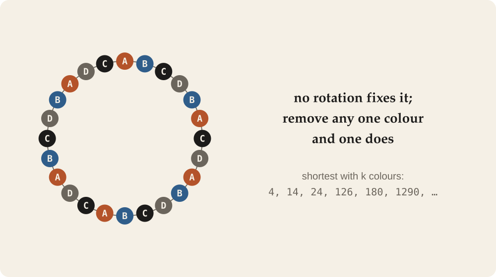</a>

<b><a href="https://github.com/jvvk/mathematics/tree/main/precarious-necklaces">Precarious necklaces</a></b> 
The shortest necklace with no rotational symmetry that gains one whenever a colour is removed has 2m·P_m beads for 2m colours and P_m(2m·p_{m+1} + 1) for 2m + 1, P_m the product of the first m primes; Weiss's question. 
<a href="https://github.com/jvvk/mathematics/tree/main/precarious-necklaces/paper">paper</a> · <a href="https://github.com/jvvk/mathematics/tree/main/precarious-necklaces/lean">Lean</a> · <a href="https://github.com/jvvk/mathematics/tree/main/precarious-necklaces/verify">code</a>

</td>
<td width="50%" valign="top">
<a href="https://github.com/jvvk/mathematics/tree/main/dao-cyclic-frobenius">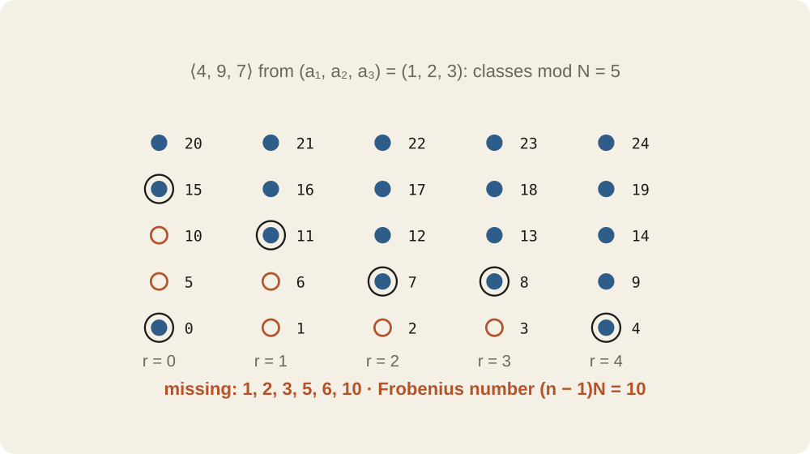</a>

<b><a href="https://github.com/jvvk/mathematics/tree/main/dao-cyclic-frobenius">The Frobenius number of Dao's cyclic semigroups</a></b> 
With x_i = 1 + a_i + a_i a_{i+1} + ⋯ (indices cyclic), the semigroup ⟨x_1, …, x_n⟩ misses exactly up to (n − 1)(a_1⋯a_n − 1), extending ab − 1 for two generators; Hailong Dao's question. 
<a href="https://github.com/jvvk/mathematics/tree/main/dao-cyclic-frobenius/paper">paper</a>

</td>
</tr>
<tr>
<td width="50%" valign="top">
<a href="https://github.com/jvvk/mathematics/tree/main/fences-orbit-maximisers">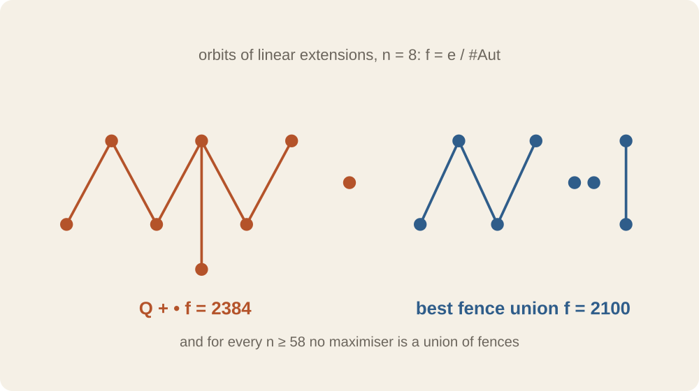</a>

<b><a href="https://github.com/jvvk/mathematics/tree/main/fences-orbit-maximisers">Fences do not maximise orbits of linear extensions</a></b> 
The posets with the most orbits of linear extensions are found exactly for n ≤ 11, and for every n ≥ 58 none is a disjoint union of fences; Richard Stanley's question. 
<a href="https://github.com/jvvk/mathematics/tree/main/fences-orbit-maximisers/paper">paper</a>

</td>
<td width="50%"></td>
</tr>
</table>

### Open problems settled, verified by computation

Proved by exhaustive search with independent cross-checks, or by hand with parts in Lean.

<table>
<tr>
<td width="50%" valign="top">
<a href="https://github.com/jvvk/mathematics/tree/main/spectre-twelve-fold">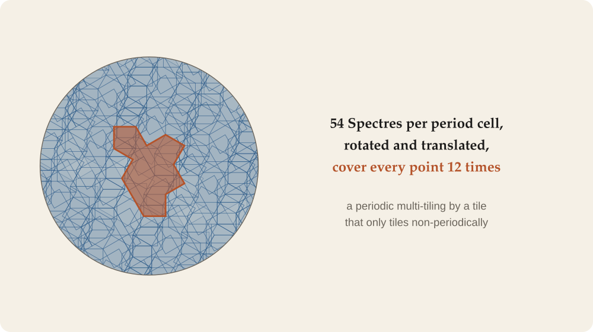</a>

<b><a href="https://github.com/jvvk/mathematics/tree/main/spectre-twelve-fold">A periodic twelve-fold tiling by the Spectre</a></b> 
The Spectre tiles the plane only non-periodically, but 54 rotated and translated copies, repeated by a lattice, cover almost every point exactly 12 times. Andrew Bayly's question. 
<a href="https://github.com/jvvk/mathematics/tree/main/spectre-twelve-fold/paper">paper</a> · <a href="https://github.com/jvvk/mathematics/tree/main/spectre-twelve-fold/lean">Lean</a> · <a href="https://github.com/jvvk/mathematics/tree/main/spectre-twelve-fold/verify">code</a> · Straight Spectre in Lean; curved Spectres by the same certificate

</td>
<td width="50%" valign="top">
<a href="https://github.com/jvvk/mathematics/tree/main/phyllotaxis-irregularity">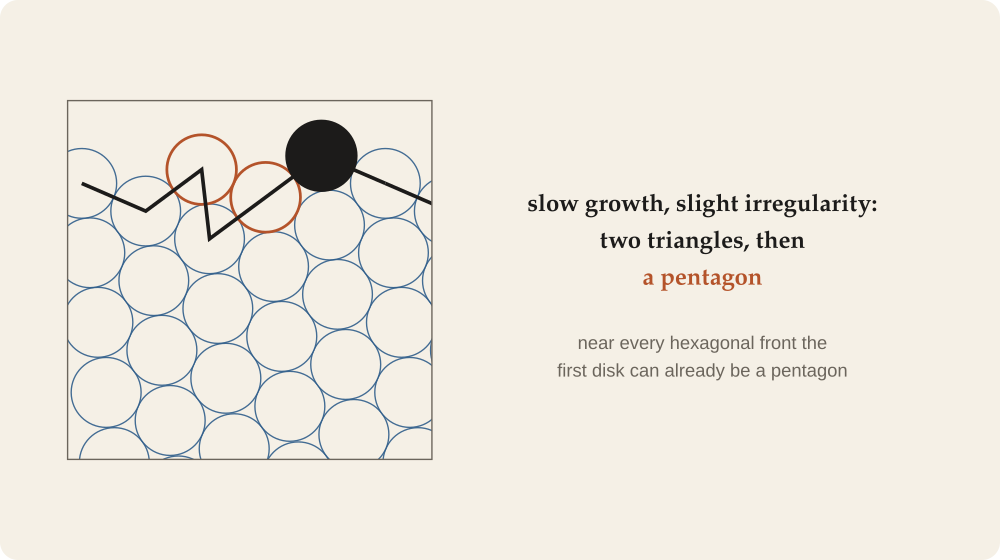</a>

<b><a href="https://github.com/jvvk/mathematics/tree/main/phyllotaxis-irregularity">Irregularity versus growth rate in phyllotaxis</a></b> 
In disk-stacking phyllotaxis, separate bounds on irregularity, notch angle and growth rate cannot guarantee a Fibonacci transition: near every hexagonal front, an explicit cone of perturbed fronts makes a pentagon on the very first disk. 
<a href="https://github.com/jvvk/mathematics/tree/main/phyllotaxis-irregularity/paper">paper</a> · <a href="https://github.com/jvvk/mathematics/tree/main/phyllotaxis-irregularity/lean">Lean</a> · <a href="https://github.com/jvvk/mathematics/tree/main/phyllotaxis-irregularity/verify">code</a> · First-order lemmas in Lean; first-disk theorem by hand

</td>
</tr>
<tr>
<td width="50%" valign="top">
<a href="https://github.com/jvvk/mathematics/tree/main/steady-state-dichotomy">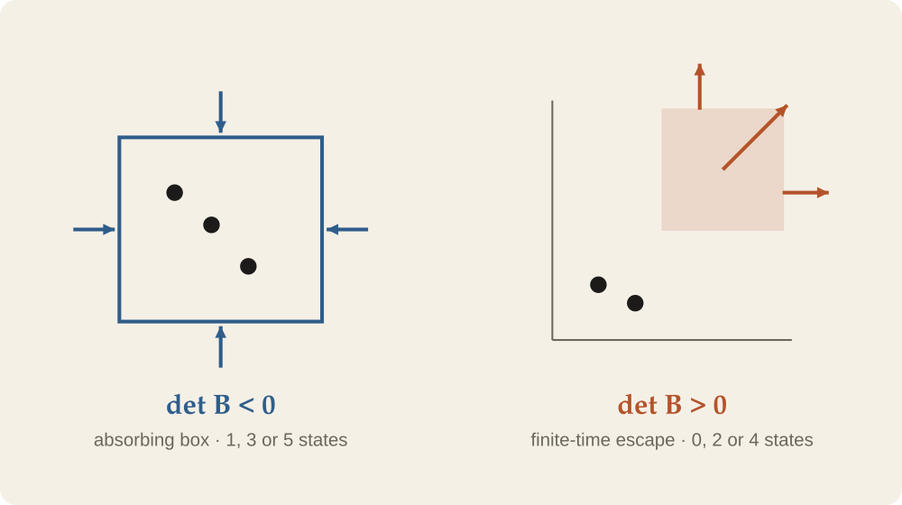</a>

<b><a href="https://github.com/jvvk/mathematics/tree/main/steady-state-dichotomy">One determinant decides the steady states</a></b> 
For three-species quadratic zero-one networks, the sign of one 3 × 3 determinant of rate constants separates an absorbing box with 1, 3 or 5 steady states from finite-time escape with 0, 2 or 4; four and five are attained. 
<a href="https://github.com/jvvk/mathematics/tree/main/steady-state-dichotomy/paper">paper</a> · <a href="https://github.com/jvvk/mathematics/tree/main/steady-state-dichotomy/lean">Lean</a> · <a href="https://github.com/jvvk/mathematics/tree/main/steady-state-dichotomy/verify">code</a> · Both extreme examples in Lean; dichotomy by hand

</td>
<td width="50%" valign="top">
<a href="https://github.com/jvvk/mathematics/tree/main/product-state-trajectories">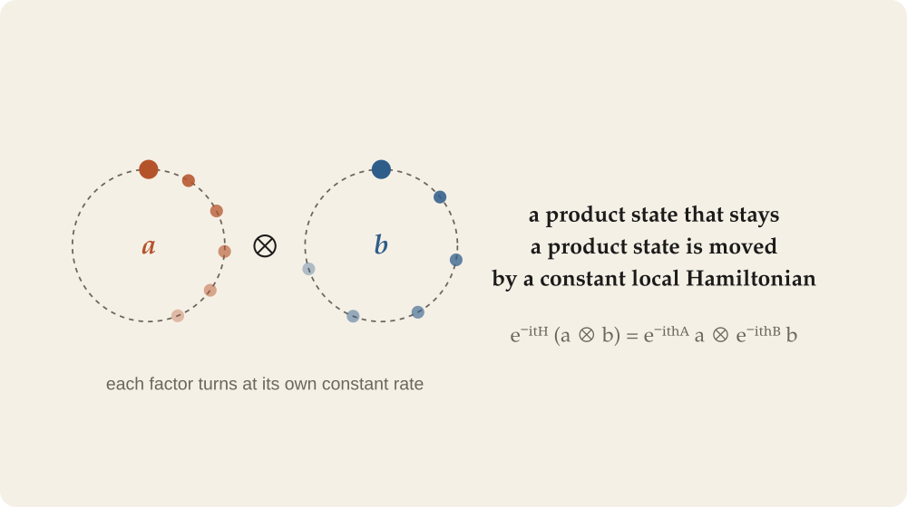</a>

<b><a href="https://github.com/jvvk/mathematics/tree/main/product-state-trajectories">When a product state stays a product state</a></b> 
If a Hamiltonian keeps one product state a product state at all times, a constant local Hamiltonian generates the same trajectory, whatever the spectrum; constant entanglement alone is not enough. A Physics Stack Exchange question. 
<a href="https://github.com/jvvk/mathematics/tree/main/product-state-trajectories/paper">paper</a> · <a href="https://github.com/jvvk/mathematics/tree/main/product-state-trajectories/lean">Lean</a> · <a href="https://github.com/jvvk/mathematics/tree/main/product-state-trajectories/verify">code</a> · Core and Section 6 in Lean; final assembly by hand

</td>
</tr>
<tr>
<td width="50%" valign="top">
<a href="https://github.com/jvvk/mathematics/tree/main/common-quartets">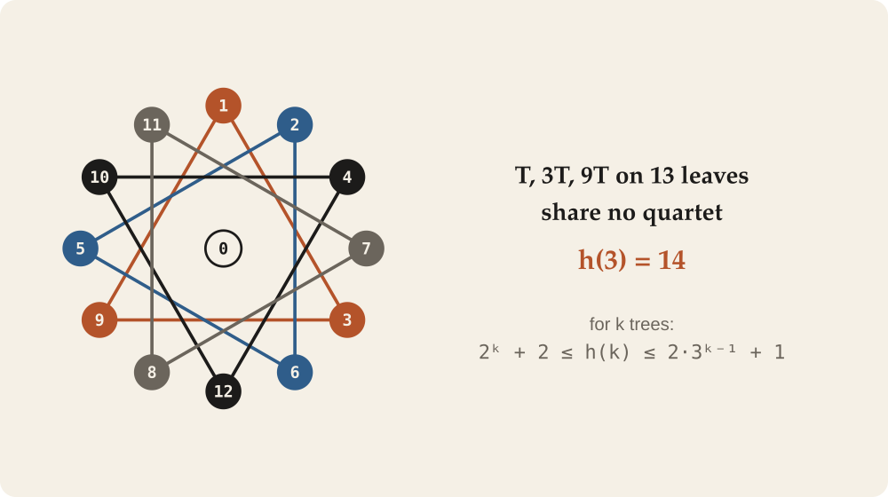</a>

<b><a href="https://github.com/jvvk/mathematics/tree/main/common-quartets">Common quartets of three trees</a></b> 
Any three phylogenetic trees on 14 species agree on some four-species subtree, and 13 is not enough; for k trees the threshold is between 2ᵏ + 2 and 2·3ᵏ⁻¹ + 1. Snir and Yuster's question. 
<a href="https://github.com/jvvk/mathematics/tree/main/common-quartets/paper">paper</a> · <a href="https://github.com/jvvk/mathematics/tree/main/common-quartets/lean">Lean</a> · <a href="https://github.com/jvvk/mathematics/tree/main/common-quartets/verify">code</a> · Bounds and examples in Lean; h(3) ≤ 14 by checked SAT proofs

</td>
<td width="50%" valign="top">
<a href="https://github.com/jvvk/mathematics/tree/main/critical-discs-cover">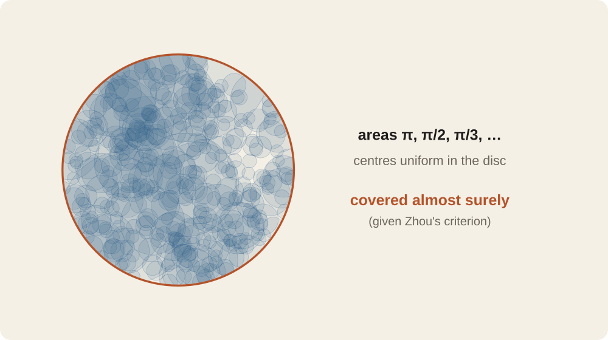</a>

<b><a href="https://github.com/jvvk/mathematics/tree/main/critical-discs-cover">Critical random discs cover the disc</a></b> 
Discs of areas π, π/2, π/3, … with uniform centres cover the unit disc almost surely, assuming Zhou's new criterion for the interior; the rim follows from Shepp's theorem. 
<a href="https://github.com/jvvk/mathematics/tree/main/critical-discs-cover/paper">paper</a> · <a href="https://github.com/jvvk/mathematics/tree/main/critical-discs-cover/lean">Lean</a> · <a href="https://github.com/jvvk/mathematics/tree/main/critical-discs-cover/verify">code</a> · Conditional on Zhou; analytic core in Lean

</td>
</tr>
<tr>
<td width="50%" valign="top">
<a href="https://github.com/jvvk/mathematics/tree/main/zeta-along-a-semicircle">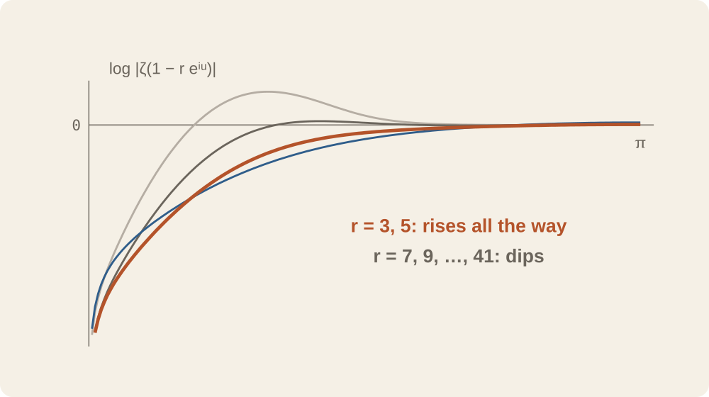</a>

<b><a href="https://github.com/jvvk/mathematics/tree/main/zeta-along-a-semicircle">Zeta along a semicircle</a></b> 
|ζ(z)| rises strictly along the semicircle from the trivial zero −4 to 6, and along the one from −2; along the semicircles through −6, −8, …, −40 it dips. Computer assisted in ball arithmetic. 
<a href="https://github.com/jvvk/mathematics/tree/main/zeta-along-a-semicircle/paper">paper</a> · <a href="https://github.com/jvvk/mathematics/tree/main/zeta-along-a-semicircle/lean">Lean</a> · <a href="https://github.com/jvvk/mathematics/tree/main/zeta-along-a-semicircle/verify">code</a> · Computer assisted; reductions in Lean

</td>
<td width="50%" valign="top">
<a href="https://github.com/jvvk/mathematics/tree/main/every-path-count-but-three">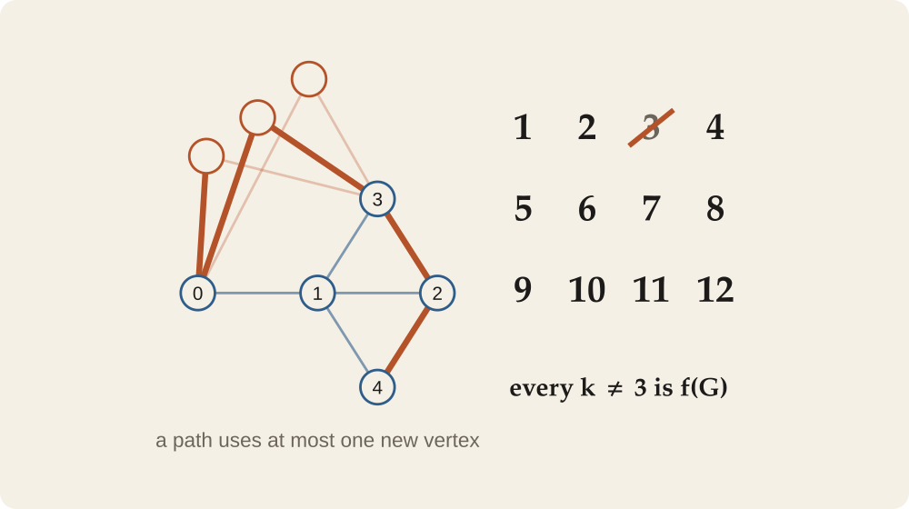</a>

<b><a href="https://github.com/jvvk/mathematics/tree/main/every-path-count-but-three">Every path count except three</a></b> 
The largest number of simple paths between two vertices of a graph can be every positive integer except 3: four families where a path can use only one added vertex give 2a, 6a + 1, 6a + 9, 6a + 11. 
<a href="https://github.com/jvvk/mathematics/tree/main/every-path-count-but-three/paper">paper</a> · <a href="https://github.com/jvvk/mathematics/tree/main/every-path-count-but-three/lean">Lean</a> · <a href="https://github.com/jvvk/mathematics/tree/main/every-path-count-but-three/verify">code</a> · Construction in Lean; 3 impossible by hand

</td>
</tr>
<tr>
<td width="50%" valign="top">
<a href="https://github.com/jvvk/mathematics/tree/main/debruijn-cycles-two-short">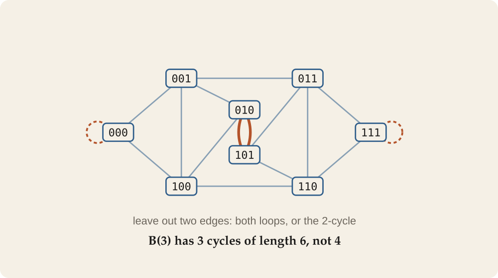</a>

<b><a href="https://github.com/jvvk/mathematics/tree/main/debruijn-cycles-two-short">De Bruijn cycles two short</a></b> 
B(n) has (2ⁿ − (−1)ⁿ)/3 · 2^(2ⁿ⁻¹ − 2n + 2) cycles of length 2ⁿ − 2, proving a 1972 count and correcting the formula printed in 1982: a rank-one Laplacian change, inverted exactly because the walk mixes in n − 1 steps. 
<a href="https://github.com/jvvk/mathematics/tree/main/debruijn-cycles-two-short/paper">paper</a> · <a href="https://github.com/jvvk/mathematics/tree/main/debruijn-cycles-two-short/lean">Lean</a> · <a href="https://github.com/jvvk/mathematics/tree/main/debruijn-cycles-two-short/verify">code</a> · Determinant algebra in Lean; BEST and matrix-tree cited

</td>
<td width="50%" valign="top">
<a href="https://github.com/jvvk/mathematics/tree/main/polygon-cells-are-small">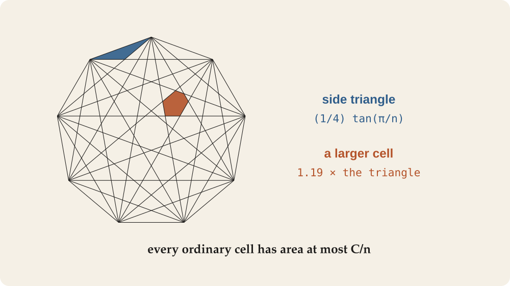</a>

<b><a href="https://github.com/jvvk/mathematics/tree/main/polygon-cells-are-small">The cells of a regular polygon are small</a></b> 
Draw every diagonal of a regular n-gon with side 1: every cell has area at most C/n, except the odd central cell (area → π/16); the side triangles are usually not the largest. 
<a href="https://github.com/jvvk/mathematics/tree/main/polygon-cells-are-small/paper">paper</a> · <a href="https://github.com/jvvk/mathematics/tree/main/polygon-cells-are-small/lean">Lean</a> · <a href="https://github.com/jvvk/mathematics/tree/main/polygon-cells-are-small/verify">code</a> · Partial answer; arithmetic core in Lean

</td>
</tr>
<tr>
<td width="50%" valign="top">
<a href="https://github.com/jvvk/mathematics/tree/main/strange-operator-twist">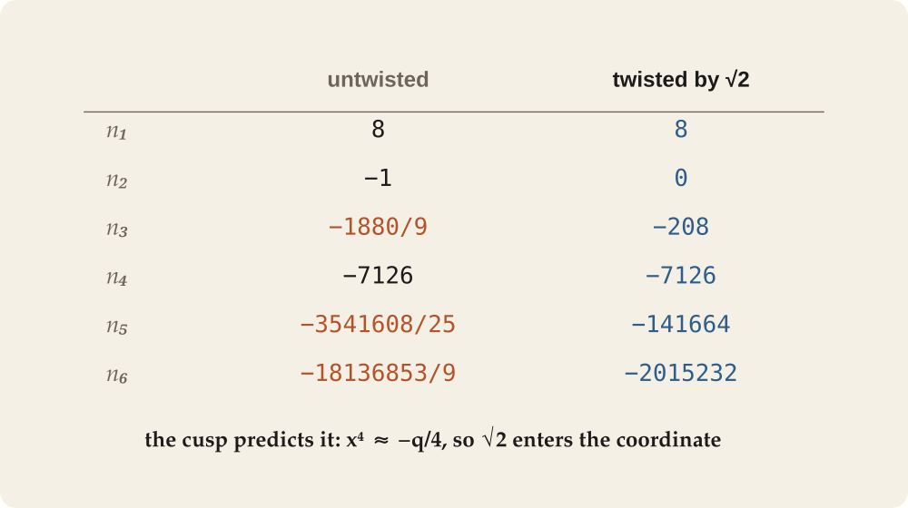</a>

<b><a href="https://github.com/jvvk/mathematics/tree/main/strange-operator-twist">Bogner's strange operator carries a √2 twist</a></b> 
A Calabi-Yau operator with integral period and mirror map but fractional instanton numbers: read through a multicover formula twisted by √2, they become integers, as the cusp predicts; proved at each p ≥ 5 given a Frobenius structure. 
<a href="https://github.com/jvvk/mathematics/tree/main/strange-operator-twist/paper">paper</a> · <a href="https://github.com/jvvk/mathematics/tree/main/strange-operator-twist/lean">Lean</a> · <a href="https://github.com/jvvk/mathematics/tree/main/strange-operator-twist/verify">code</a> · Conditional theorem; elementary algebra in Lean

</td>
<td width="50%" valign="top">
<a href="https://github.com/jvvk/mathematics/tree/main/incomplete-open-solids">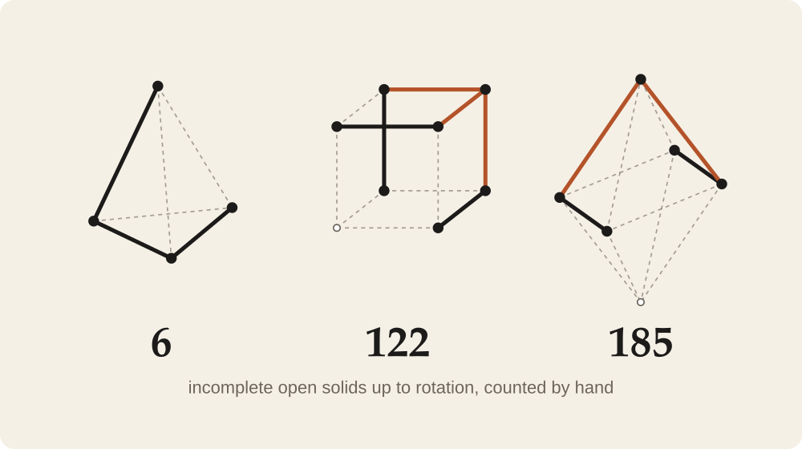</a>

<b><a href="https://github.com/jvvk/mathematics/tree/main/incomplete-open-solids">Incomplete open solids by hand</a></b> 
LeWitt's 122 incomplete open cubes counted with pencil and paper, and the same for the tetrahedron (6) and the octahedron (185): Burnside for many edges, spanning trees after deleting unused vertices for few. 
<a href="https://github.com/jvvk/mathematics/tree/main/incomplete-open-solids/paper">paper</a> · <a href="https://github.com/jvvk/mathematics/tree/main/incomplete-open-solids/lean">Lean</a> · <a href="https://github.com/jvvk/mathematics/tree/main/incomplete-open-solids/verify">code</a> · Finite counts in Lean

</td>
</tr>
<tr>
<td width="50%" valign="top">
<a href="https://github.com/jvvk/mathematics/tree/main/four-acute-faces">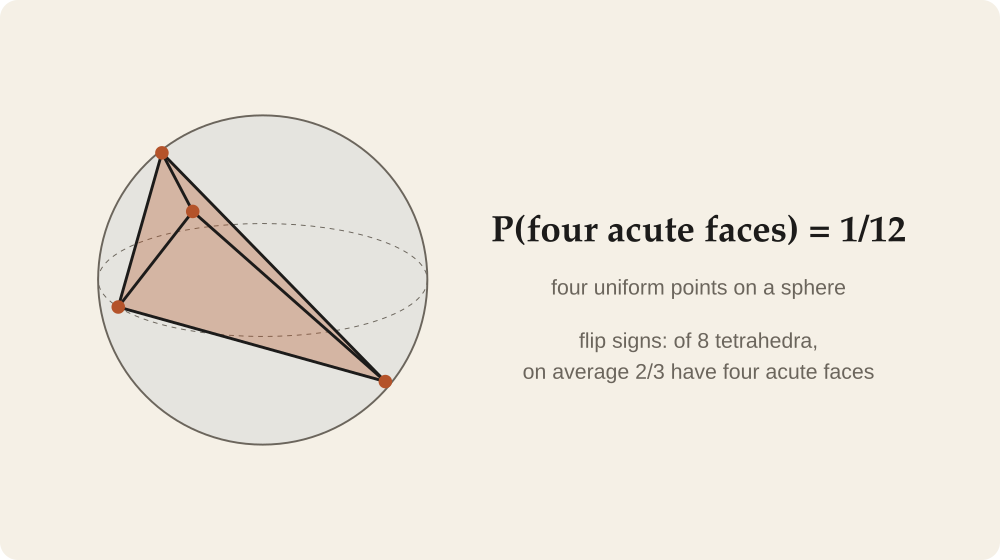</a>

<b><a href="https://github.com/jvvk/mathematics/tree/main/four-acute-faces">Four acute faces</a></b> 
Four random points on a sphere span a tetrahedron with four acute faces with probability exactly 1/12: flipping signs gives eight tetrahedra, and on average 2/3 of them succeed. 
<a href="https://github.com/jvvk/mathematics/tree/main/four-acute-faces/paper">paper</a> · <a href="https://github.com/jvvk/mathematics/tree/main/four-acute-faces/lean">Lean</a> · <a href="https://github.com/jvvk/mathematics/tree/main/four-acute-faces/verify">code</a> · In Lean, including the probability

</td>
<td width="50%" valign="top">
<a href="https://github.com/jvvk/mathematics/tree/main/every-other-residue">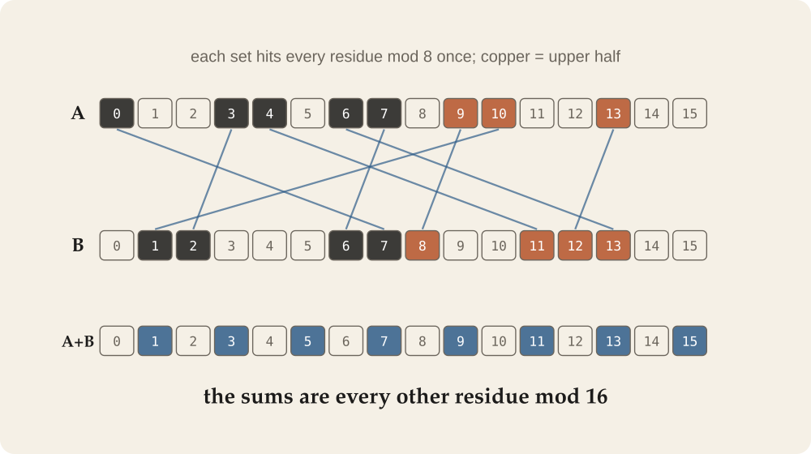</a>

<b><a href="https://github.com/jvvk/mathematics/tree/main/every-other-residue">Every other residue</a></b> 
Two sets that each hit every residue mod 2^k once can be matched inside Z/2^(k+1) so that the sums are exactly the even or exactly the odd residues; a case of Snevily's even-order conjecture. 
<a href="https://github.com/jvvk/mathematics/tree/main/every-other-residue/paper">paper</a> · <a href="https://github.com/jvvk/mathematics/tree/main/every-other-residue/lean">Lean</a> · <a href="https://github.com/jvvk/mathematics/tree/main/every-other-residue/verify">code</a> · In Lean

</td>
</tr>
<tr>
<td width="50%" valign="top">

<b><a href="https://github.com/jvvk/mathematics/tree/main/equal-perimeter-rectangles">Equal perimeters, no two alike</a></b> 
A square splits into nine rectangles of equal perimeter, no two congruent; nine is the fewest, with exactly five solutions. 
<a href="https://github.com/jvvk/mathematics/tree/main/equal-perimeter-rectangles/paper">paper</a> · <a href="https://github.com/jvvk/mathematics/tree/main/equal-perimeter-rectangles/verify">code</a> · Exhaustive search, two independent programs

</td>
<td width="50%" valign="top">

<b><a href="https://github.com/jvvk/mathematics/tree/main/squared-rectangle-697x611">697 × 611 in fourteen squares</a></b> 
The rectangle needs exactly fourteen squares, not seventeen, so it is not a counterexample to the minimal squaring conjecture. 
<a href="https://github.com/jvvk/mathematics/tree/main/squared-rectangle-697x611/paper">paper</a> · <a href="https://github.com/jvvk/mathematics/tree/main/squared-rectangle-697x611/verify">code</a> · Complete enumeration, checked against OEIS

</td>
</tr>
<tr>
<td width="50%" valign="top">

<b><a href="https://github.com/jvvk/mathematics/tree/main/math-magic-problems">Three armies of bishops</a></b> 
Three armies of five bishops fit on a 5 × 5 board and three of eight on 6 × 6, and no more: Friedman's two values. 
<a href="https://github.com/jvvk/mathematics/tree/main/math-magic-problems/paper">paper</a> · <a href="https://github.com/jvvk/mathematics/tree/main/math-magic-problems/verify">code</a> · Exhaustive count of diagonal labellings

</td>
<td width="50%" valign="top">

<b><a href="https://github.com/jvvk/mathematics/tree/main/math-magic-problems">Chess capture patterns</a></b> 
Friedman's capture digraphs q, r and s are not made by any chess position, on any board. 
<a href="https://github.com/jvvk/mathematics/tree/main/math-magic-problems/paper">paper</a> · <a href="https://github.com/jvvk/mathematics/tree/main/math-magic-problems/verify">code</a> · Two independent solvers

</td>
</tr>
<tr>
<td width="50%" valign="top">

<b><a href="https://github.com/jvvk/mathematics/tree/main/math-magic-problems">Kings that touch in a cycle</a></b> 
Kings with touch counts (1,3,6), (1,6,3) or (2,3,4) admit no finite arrangement: Friedman's unsolved problem 24. 
<a href="https://github.com/jvvk/mathematics/tree/main/math-magic-problems/paper">paper</a> · <a href="https://github.com/jvvk/mathematics/tree/main/math-magic-problems/verify">code</a> · DRUP certificates, independent Z3 check

</td>
<td width="50%" valign="top">

<b><a href="https://github.com/jvvk/mathematics/tree/main/math-magic-problems">A heptomino that never balances</a></b> 
This heptomino never fills a square with equal row and column counts, in any size: one shape of Friedman's problem 15. 
<a href="https://github.com/jvvk/mathematics/tree/main/math-magic-problems/paper">paper</a> · <a href="https://github.com/jvvk/mathematics/tree/main/math-magic-problems/verify">code</a> · Proof by hand, exact checker

</td>
</tr>
<tr>
<td width="50%" valign="top">

<b><a href="https://github.com/jvvk/mathematics/tree/main/math-magic-problems">A tournament schedule that beats the table</a></b> 
Friedman's optimal tournaments: exact best schedules over all adaptive plans, two of them better than the published values. 
<a href="https://github.com/jvvk/mathematics/tree/main/math-magic-problems/paper">paper</a> · <a href="https://github.com/jvvk/mathematics/tree/main/math-magic-problems/verify">code</a> · Exact recursion, two programs

</td>
<td width="50%" valign="top">

<b><a href="https://github.com/jvvk/mathematics/tree/main/math-magic-problems">A misfiled prime signature</a></b> 
In Friedman's prime-signature table, 1022303⁴ belongs in cell (4, 411), where it is the smallest; cell (4, 41) is empty. 
<a href="https://github.com/jvvk/mathematics/tree/main/math-magic-problems/paper">paper</a> · <a href="https://github.com/jvvk/mathematics/tree/main/math-magic-problems/verify">code</a> · Proof by hand, computer search

</td>
</tr>
<tr>
<td width="50%" valign="top">

<b><a href="https://github.com/jvvk/mathematics/tree/main/powers-of-four-representations">Deleting the powers of four</a></b> 
Remove 16, 64, 256, … and the ordered ways to write n as a sum of three survivors still rise at every n: Sándor and Yang's Remark 1.3. 
<a href="https://github.com/jvvk/mathematics/tree/main/powers-of-four-representations/paper">paper</a> · <a href="https://github.com/jvvk/mathematics/tree/main/powers-of-four-representations/lean">Lean</a> · <a href="https://github.com/jvvk/mathematics/tree/main/powers-of-four-representations/verify">code</a> · Proposition 1 in Lean; Problem 1.4 facts by hand

</td>
<td width="50%" valign="top">

<b><a href="https://github.com/jvvk/mathematics/tree/main/tangent-circles-incentre">Three circles and a fair coin</a></b> 
A triangle through random points on three touching circles contains the incentre with probability exactly 1/2, for all radii. 
<a href="https://github.com/jvvk/mathematics/tree/main/tangent-circles-incentre/paper">paper</a> · <a href="https://github.com/jvvk/mathematics/tree/main/tangent-circles-incentre/lean">Lean</a> · <a href="https://github.com/jvvk/mathematics/tree/main/tangent-circles-incentre/verify">code</a> · Partly in Lean; geometry by hand

</td>
</tr>
<tr>
<td width="50%" valign="top">

<b><a href="https://github.com/jvvk/mathematics/tree/main/zero-sum-selection-game">A zero-sum selection game</a></b> 
Lev's question: the winning matrices form a union of subspaces of dimension n(n+1)/2 − 1, and recognising them is Π₂ᵖ-complete. 
<a href="https://github.com/jvvk/mathematics/tree/main/zero-sum-selection-game/paper">paper</a> · <a href="https://github.com/jvvk/mathematics/tree/main/zero-sum-selection-game/lean">Lean</a> · <a href="https://github.com/jvvk/mathematics/tree/main/zero-sum-selection-game/verify">code</a> · Partly in Lean; reduction by hand

</td>
<td width="50%" valign="top">
<a href="https://github.com/jvvk/mathematics/tree/main/inverse-pairs-five">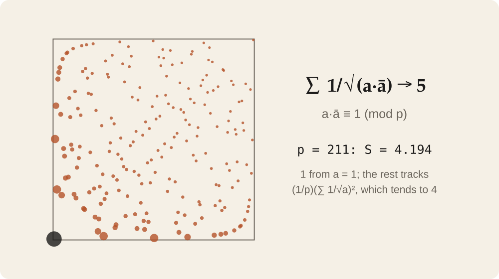</a>

<b><a href="https://github.com/jvvk/mathematics/tree/main/inverse-pairs-five">Five from inverse pairs</a></b> 
Summing 1/√(a·ā) over a and its inverse mod p gives 5 + O(p^(−1/8+ε)): the inverse pairs behave like all pairs, and those sum to (∑ 1/√a)²/p → 4. 
<a href="https://github.com/jvvk/mathematics/tree/main/inverse-pairs-five/paper">paper</a> · <a href="https://github.com/jvvk/mathematics/tree/main/inverse-pairs-five/lean">Lean</a> · <a href="https://github.com/jvvk/mathematics/tree/main/inverse-pairs-five/verify">code</a> · In Lean, assuming Weil's bound

</td>
</tr>
<tr>
<td width="50%" valign="top">
<a href="https://github.com/jvvk/mathematics/tree/main/easiest-dice">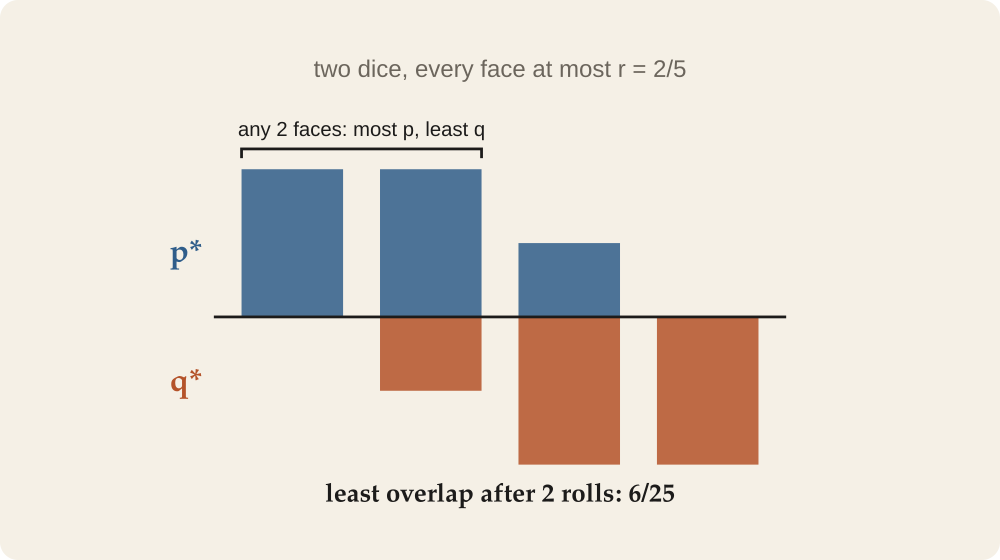</a>

<b><a href="https://github.com/jvvk/mathematics/tree/main/easiest-dice">The easiest dice to tell apart</a></b> 
Among loaded dice whose faces are capped at probability r, a staircase against its own reversal is the easiest pair to tell apart, for any number of faces and rolls; this answers an open Math.SE question with its equality cases. 
<a href="https://github.com/jvvk/mathematics/tree/main/easiest-dice/paper">paper</a> · <a href="https://github.com/jvvk/mathematics/tree/main/easiest-dice/lean">Lean</a> · <a href="https://github.com/jvvk/mathematics/tree/main/easiest-dice/verify">code</a> · In Lean; equality cases for two rolls partly open

</td>
<td width="50%" valign="top">
<a href="https://github.com/jvvk/mathematics/tree/main/tanh-product-integral">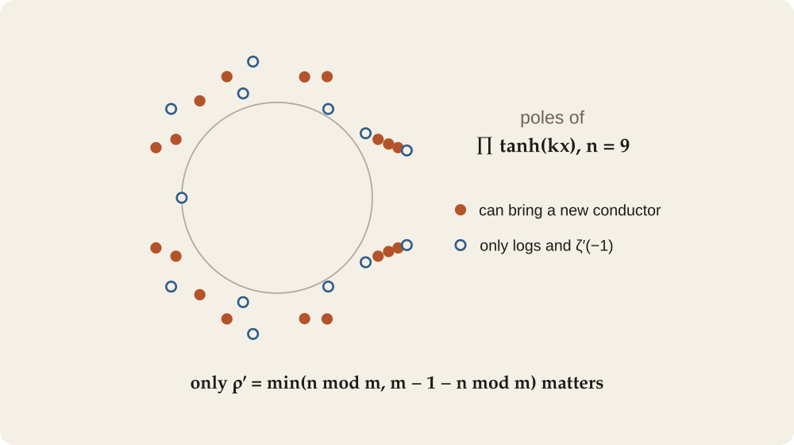</a>

<b><a href="https://github.com/jvvk/mathematics/tree/main/tanh-product-integral">An integral of hyperbolic tangents</a></b> 
The integral of tanh(x)tanh(2x)⋯tanh(nx)/x² reduces, for odd n, to logarithms and L′(−1) values with explicit coefficients; a cotangent symmetry explains which conductors appear, answering an open Math.SE question. 
<a href="https://github.com/jvvk/mathematics/tree/main/tanh-product-integral/paper">paper</a> · <a href="https://github.com/jvvk/mathematics/tree/main/tanh-product-integral/lean">Lean</a> · <a href="https://github.com/jvvk/mathematics/tree/main/tanh-product-integral/verify">code</a> · Residue steps in Lean; analytic steps cited

</td>
</tr>
</table>

### Partial progress

Part of the question answered; the rest is still open.

<table>
<tr>
<td width="50%" valign="top">
<a href="https://github.com/jvvk/mathematics/tree/main/colour-the-points">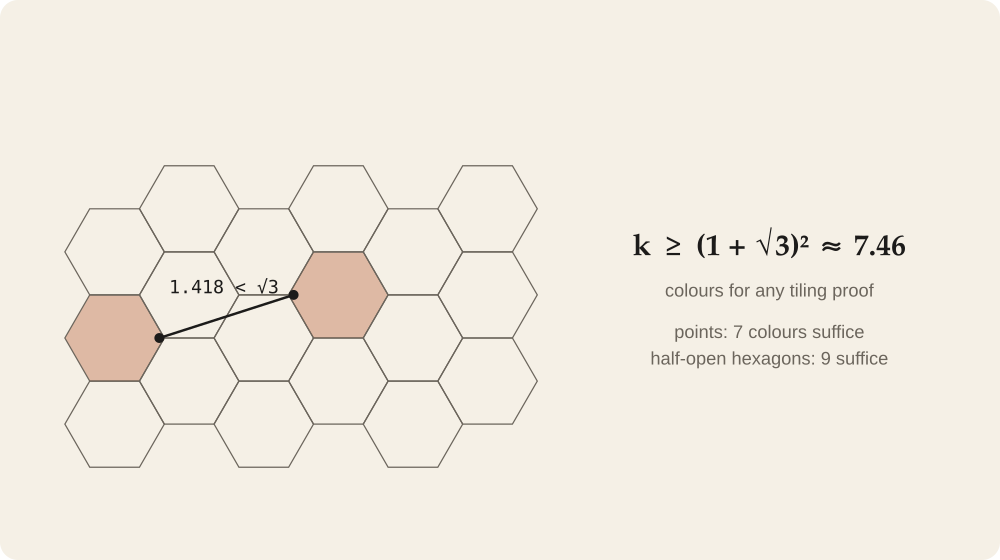</a>

<b><a href="https://github.com/jvvk/mathematics/tree/main/colour-the-points">Colour the points, not the plane</a></b> 
Points pairwise ≥ 1 apart contain N/7 pairwise more than √3 apart, but no tiling with seven colours proves it: every tiling scheme needs (1 + √3)² ≈ 7.46 colours, and nine half-open hexagon classes suffice. 
<a href="https://github.com/jvvk/mathematics/tree/main/colour-the-points/paper">paper</a> · <a href="https://github.com/jvvk/mathematics/tree/main/colour-the-points/lean">Lean</a> · <a href="https://github.com/jvvk/mathematics/tree/main/colour-the-points/verify">code</a> · Lemma, bound arithmetic and counterexample in Lean; eight open

</td>
<td width="50%" valign="top">
<a href="https://github.com/jvvk/mathematics/tree/main/coins-in-a-tray">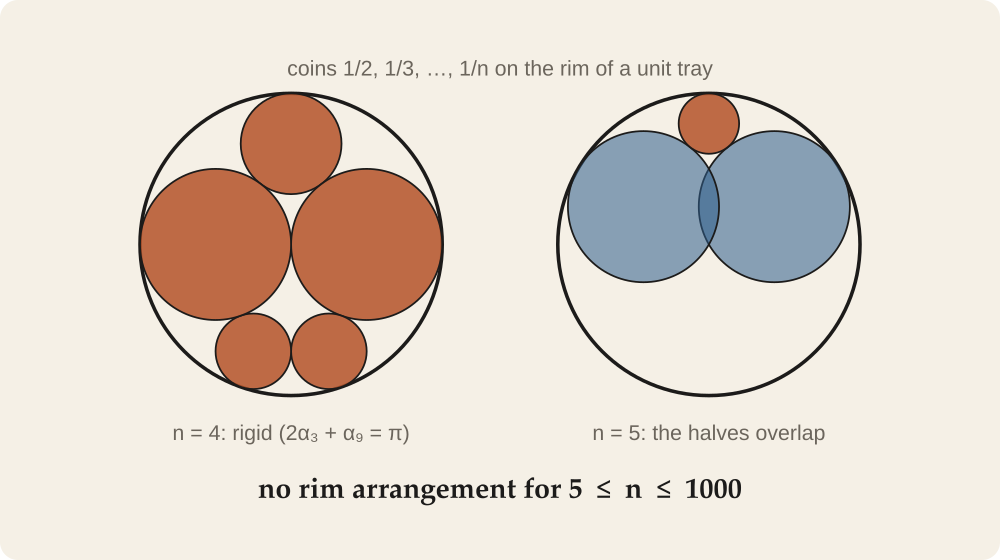</a>

<b><a href="https://github.com/jvvk/mathematics/tree/main/coins-in-a-tray">Coins in a tray</a></b> 
Coins of radii 1/2, …, 1/n cannot be held rigidly around the rim of a unit tray for any 5 ≤ n ≤ 1000, nor in a triangulated arrangement for 5 ≤ n ≤ 16; angle relations are decided exactly by prime-ideal valuations. 
<a href="https://github.com/jvvk/mathematics/tree/main/coins-in-a-tray/paper">paper</a> · <a href="https://github.com/jvvk/mathematics/tree/main/coins-in-a-tray/lean">Lean</a> · <a href="https://github.com/jvvk/mathematics/tree/main/coins-in-a-tray/verify">code</a> · Key lemmas in Lean; searches exact

</td>
</tr>
<tr>
<td width="50%" valign="top">

<b><a href="https://github.com/jvvk/mathematics/tree/main/latin-squares-small-rank">Latin squares of small rank</a></b> 
Every Latin square of order n has rank at least 1 + 3(n−1)/(n+1), so at least 4 from n = 5 on; the least ranks up to order 8 are 1, 2, 3, 3, 5, 4, 6, 4. 
<a href="https://github.com/jvvk/mathematics/tree/main/latin-squares-small-rank/paper">paper</a> · <a href="https://github.com/jvvk/mathematics/tree/main/latin-squares-small-rank/lean">Lean</a> · <a href="https://github.com/jvvk/mathematics/tree/main/latin-squares-small-rank/verify">code</a> · Bound and r(6), r(8) in Lean; r(5), r(7) by exact search

</td>
<td width="50%" valign="top">

<b><a href="https://github.com/jvvk/mathematics/tree/main/good-permutations-mersenne">Permutations with no whole-number averages</a></b> 
The asker's permutation has no block with a whole-number average exactly when n is prime, and n = 15 and 63 have no such permutation at all; that n must be 2ᵐ − 1 is Bîsceanu's theorem. 
<a href="https://github.com/jvvk/mathematics/tree/main/good-permutations-mersenne/paper">paper</a> · <a href="https://github.com/jvvk/mathematics/tree/main/good-permutations-mersenne/lean">Lean</a> · <a href="https://github.com/jvvk/mathematics/tree/main/good-permutations-mersenne/verify">code</a> · Theorems in Lean; n ≤ 63 by two searches

</td>
</tr>
<tr>
<td width="50%" valign="top">

<b><a href="https://github.com/jvvk/mathematics/tree/main/catching-the-centroid">Catching the centroid</a></b> 
A circle on a random diameter of a convex region contains the centroid with probability at most 14/27 ≈ 0.5185; the equilateral triangle's 0.5164 is conjectured best. 
<a href="https://github.com/jvvk/mathematics/tree/main/catching-the-centroid/paper">paper</a> · <a href="https://github.com/jvvk/mathematics/tree/main/catching-the-centroid/lean">Lean</a> · <a href="https://github.com/jvvk/mathematics/tree/main/catching-the-centroid/verify">code</a> · Bounds in Lean; sharp value open

</td>
<td width="50%" valign="top">

<b><a href="https://github.com/jvvk/mathematics/tree/main/broken-stick-feynman">A broken stick and a Feynman diagram</a></b> 
The chance that six random pieces of a stick make a tetrahedron is a three-loop Feynman diagram; it is 0.0125749944…, not 1/79. 
<a href="https://github.com/jvvk/mathematics/tree/main/broken-stick-feynman/paper">paper</a> · <a href="https://github.com/jvvk/mathematics/tree/main/broken-stick-feynman/lean">Lean</a> · <a href="https://github.com/jvvk/mathematics/tree/main/broken-stick-feynman/verify">code</a> · Algebra in Lean; no closed form

</td>
</tr>
<tr>
<td width="50%" valign="top">

<b><a href="https://github.com/jvvk/mathematics/tree/main/prime-squares-half-turns">Prime squares and half-turns</a></b> 
A p × p square, p prime, cut into p congruent pieces that are only translated or half-turned must be cut into bars; with quarter-turns too, the question is open. 
<a href="https://github.com/jvvk/mathematics/tree/main/prime-squares-half-turns/paper">paper</a> · <a href="https://github.com/jvvk/mathematics/tree/main/prime-squares-half-turns/lean">Lean</a> · <a href="https://github.com/jvvk/mathematics/tree/main/prime-squares-half-turns/verify">code</a> · Algebra in Lean; full question open

</td>
<td width="50%" valign="top">

<b><a href="https://github.com/jvvk/mathematics/tree/main/five-numbers-many-averages">Five numbers, many averages</a></b> 
Replacing two numbers by their average, the five integers (5N, 0, 4N, 3N±5, 3N±5) with N = 2ᵏ⁺¹ need exactly k + 3 moves to become equal, so five numbers have no bound on the shortest solution. 
<a href="https://github.com/jvvk/mathematics/tree/main/five-numbers-many-averages/paper">paper</a> · <a href="https://github.com/jvvk/mathematics/tree/main/five-numbers-many-averages/lean">Lean</a> · <a href="https://github.com/jvvk/mathematics/tree/main/five-numbers-many-averages/verify">code</a> · In Lean; which lists are solvable is open

</td>
</tr>
<tr>
<td width="50%" valign="top">

<b><a href="https://github.com/jvvk/mathematics/tree/main/why-the-sphere-beats-the-ball">Why the sphere beats the ball</a></b> 
Three points on concentric spheres form an acute triangle with probability at most 1/2, equal only when the two outer radii agree; so the uniform sphere beats every rotationally invariant law in space, while in the plane moving mass inwards helps. 
<a href="https://github.com/jvvk/mathematics/tree/main/why-the-sphere-beats-the-ball/paper">paper</a> · <a href="https://github.com/jvvk/mathematics/tree/main/why-the-sphere-beats-the-ball/lean">Lean</a> · <a href="https://github.com/jvvk/mathematics/tree/main/why-the-sphere-beats-the-ball/verify">code</a> · Formula and bound in Lean; the disc's gain unexplained

</td>
<td width="50%" valign="top">

<b><a href="https://github.com/jvvk/mathematics/tree/main/raising-the-apex">Raising the apex raises the Gaussian centroid</a></b> 
Raise a triangle's apex along the perpendicular through a point of its base and the Gaussian centre of mass rises, in every dimension and wherever the Gaussian is centred; whether it always pins down the moving vertex is open. 
<a href="https://github.com/jvvk/mathematics/tree/main/raising-the-apex/paper">paper</a> · <a href="https://github.com/jvvk/mathematics/tree/main/raising-the-apex/lean">Lean</a> · <a href="https://github.com/jvvk/mathematics/tree/main/raising-the-apex/verify">code</a> · Steps after Prékopa's theorem in Lean; oblique case open

</td>
</tr>
<tr>
<td width="50%" valign="top">
<a href="https://github.com/jvvk/mathematics/tree/main/sixteen-words">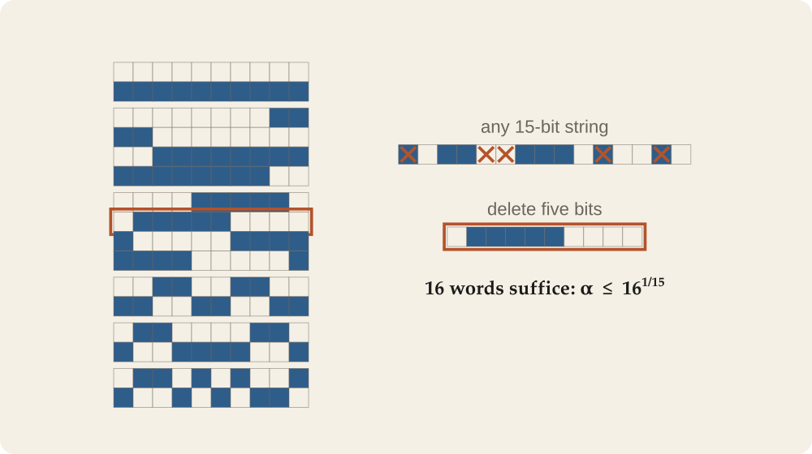</a>

<b><a href="https://github.com/jvvk/mathematics/tree/main/sixteen-words">Sixteen words cover all 15-bit strings</a></b> 
Deleting five bits from every 15-bit string can leave just 16 different strings, down from 17 in 2013, so the growth rate of the n/3-deletion problem is at most 16^(1/15) < 1.2031; among symmetric sets 16 is optimal. 
<a href="https://github.com/jvvk/mathematics/tree/main/sixteen-words/paper">paper</a> · <a href="https://github.com/jvvk/mathematics/tree/main/sixteen-words/lean">Lean</a> · <a href="https://github.com/jvvk/mathematics/tree/main/sixteen-words/verify">code</a> · Rate argument in Lean; cover and optimality by certified computation

</td>
<td width="50%" valign="top">

<b><a href="https://github.com/jvvk/mathematics/tree/main/unit-hexagon-diameter">Six matchsticks in a square</a></b> 
No simple loop of six unit sticks fits in a unit square: the six-stick case of an open parity question. 
<a href="https://github.com/jvvk/mathematics/tree/main/unit-hexagon-diameter/paper">paper</a> · <a href="https://github.com/jvvk/mathematics/tree/main/unit-hexagon-diameter/lean">Lean</a> · <a href="https://github.com/jvvk/mathematics/tree/main/unit-hexagon-diameter/verify">code</a> · Partly in Lean

</td>
</tr>
<tr>
<td width="50%" valign="top">

<b><a href="https://github.com/jvvk/mathematics/tree/main/randomized-pascal-triangle">A randomized Pascal triangle</a></b> 
The expected average blows up whenever p ≥ 0.232; whether it does for every p > 0 is open. 
<a href="https://github.com/jvvk/mathematics/tree/main/randomized-pascal-triangle/paper">paper</a> · <a href="https://github.com/jvvk/mathematics/tree/main/randomized-pascal-triangle/lean">Lean</a> · <a href="https://github.com/jvvk/mathematics/tree/main/randomized-pascal-triangle/verify">code</a> · In Lean

</td>
<td width="50%" valign="top">

<b><a href="https://github.com/jvvk/mathematics/tree/main/power-two-tree-labels">Labelling binary trees by powers of two</a></b> 
Every tree with at most 24 vertices can be labelled 0 to n − 1 with power-of-two steps; five constructions and an exact rule for universal label sets narrow any counterexample. 
<a href="https://github.com/jvvk/mathematics/tree/main/power-two-tree-labels/paper">paper</a> · <a href="https://github.com/jvvk/mathematics/tree/main/power-two-tree-labels/lean">Lean</a> · <a href="https://github.com/jvvk/mathematics/tree/main/power-two-tree-labels/verify">code</a> · Constructions and lemmas in Lean; searches by two programs

</td>
</tr>
<tr>
<td width="50%" valign="top">

<b><a href="https://github.com/jvvk/mathematics/tree/main/wandering-over-divisors">Wandering over the divisors of 10ⁿ</a></b> 
Players multiply by 2 or 5 or divide by 10, never repeating a divisor. The tournament's natural answer fails from 10⁶ on, and the second player beats whole families of openings on every board. 
<a href="https://github.com/jvvk/mathematics/tree/main/wandering-over-divisors/paper">paper</a> · <a href="https://github.com/jvvk/mathematics/tree/main/wandering-over-divisors/lean">Lean</a> · <a href="https://github.com/jvvk/mathematics/tree/main/wandering-over-divisors/verify">code</a> · Theorems in Lean; tables by two programs

</td>
<td width="50%" valign="top">

<b><a href="https://github.com/jvvk/mathematics/tree/main/every-taxicab-distance-once">Eleven points, distances 1 to 55</a></b> 
Eleven lattice points whose 55 taxicab distances are exactly 1 to 55; with the parity count (n or n − 2 a square), placements exist for every allowed n ≤ 15. 
<a href="https://github.com/jvvk/mathematics/tree/main/every-taxicab-distance-once/paper">paper</a> · <a href="https://github.com/jvvk/mathematics/tree/main/every-taxicab-distance-once/lean">Lean</a> · <a href="https://github.com/jvvk/mathematics/tree/main/every-taxicab-distance-once/verify">code</a> · Parity count and n = 11 in Lean; n ≥ 16 open

</td>
</tr>
<tr>
<td width="50%" valign="top">

<b><a href="https://github.com/jvvk/mathematics/tree/main/cube-unfoldings-tile-space">Unfolded cubes that tile space</a></b> 
Every one of the 502,110 unfoldings of the six-dimensional cube tiles five-space with its point reflection, extending Firet's five-cube result. 
<a href="https://github.com/jvvk/mathematics/tree/main/cube-unfoldings-tile-space/paper">paper</a> · <a href="https://github.com/jvvk/mathematics/tree/main/cube-unfoldings-tile-space/lean">Lean</a> · <a href="https://github.com/jvvk/mathematics/tree/main/cube-unfoldings-tile-space/verify">code</a> · Certificates, two checkers; lemmas in Lean

</td>
<td width="50%" valign="top">

<b><a href="https://github.com/jvvk/mathematics/tree/main/balanced-tree-agreement-subtrees">How much two balanced trees must share</a></b> 
Two balanced trees on n leaves always agree on at least n^0.243 leaves, and some on only n^(5/11); Martin and Thatte conjectured n^(1/2). 
<a href="https://github.com/jvvk/mathematics/tree/main/balanced-tree-agreement-subtrees/paper">paper</a> · <a href="https://github.com/jvvk/mathematics/tree/main/balanced-tree-agreement-subtrees/lean">Lean</a> · <a href="https://github.com/jvvk/mathematics/tree/main/balanced-tree-agreement-subtrees/verify">code</a> · Lean, except one certified inequality

</td>
</tr>
<tr>
<td width="50%" valign="top">

<b><a href="https://github.com/jvvk/mathematics/tree/main/math-magic-problems">Cubes cut into slabs</a></b> 
A cube made of one k-slab for each k ≤ n has side at most n(n+1)/2, and none exists for n = 4, 5, 6; Friedman conjectures infinitely many. 
<a href="https://github.com/jvvk/mathematics/tree/main/math-magic-problems/paper">paper</a> · <a href="https://github.com/jvvk/mathematics/tree/main/math-magic-problems/verify">code</a> · Bound by hand, n = 4 to 6 by two searches

</td>
<td width="50%" valign="top">

<b><a href="https://github.com/jvvk/mathematics/tree/main/span-maximising-chains">The chain that reaches farthest</a></b> 
Every best chain has lengths rising then falling; exactly three orders occur for four segments, and the general count is open. 
<a href="https://github.com/jvvk/mathematics/tree/main/span-maximising-chains/paper">paper</a> · <a href="https://github.com/jvvk/mathematics/tree/main/span-maximising-chains/lean">Lean</a> · <a href="https://github.com/jvvk/mathematics/tree/main/span-maximising-chains/verify">code</a> · Shape theorem in Lean

</td>
</tr>
<tr>
<td width="50%" valign="top">
<a href="https://github.com/jvvk/mathematics/tree/main/polyomino-rectangle-parity">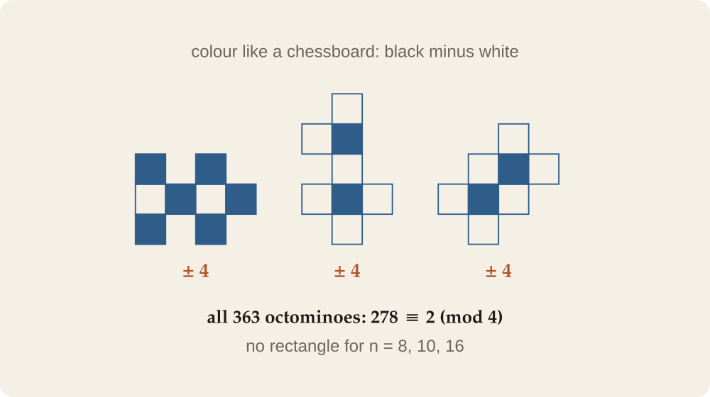</a>

<b><a href="https://github.com/jvvk/mathematics/tree/main/polyomino-rectangle-parity">Polyomino rectangles by parity</a></b> 
One copy of every hole-free n-omino tiles no rectangle for n = 8, 10 or 16, because the pieces' checkerboard imbalances add up to 2 mod 4 (for n = 16, over 11,230,003 pieces). Sizes 9 and 11 to 15 stay open. 
<a href="https://github.com/jvvk/mathematics/tree/main/polyomino-rectangle-parity/paper">paper</a> · <a href="https://github.com/jvvk/mathematics/tree/main/polyomino-rectangle-parity/lean">Lean</a> · <a href="https://github.com/jvvk/mathematics/tree/main/polyomino-rectangle-parity/verify">code</a> · Parity argument in Lean; totals by two enumerations

</td>
<td width="50%" valign="top">
<a href="https://github.com/jvvk/mathematics/tree/main/boomerangs-polya-orchard">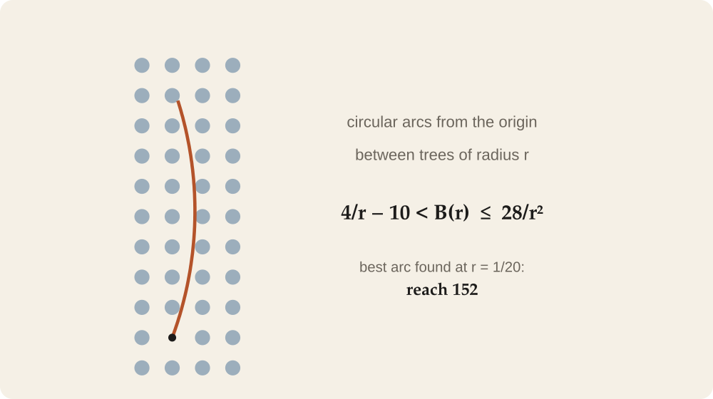</a>

<b><a href="https://github.com/jvvk/mathematics/tree/main/boomerangs-polya-orchard">Boomerangs in Pólya's orchard</a></b> 
With trees of radius r at the lattice points, a circular arc from the origin can see farther than any straight line: between 4/r − 10 and 28/r². The true order of growth is open. 
<a href="https://github.com/jvvk/mathematics/tree/main/boomerangs-polya-orchard/paper">paper</a> · <a href="https://github.com/jvvk/mathematics/tree/main/boomerangs-polya-orchard/lean">Lean</a> · <a href="https://github.com/jvvk/mathematics/tree/main/boomerangs-polya-orchard/verify">code</a> · Bounds in Lean; arcs certified exactly

</td>
</tr>
<tr>
<td width="50%" valign="top">
<a href="https://github.com/jvvk/mathematics/tree/main/binary-word-polynomials">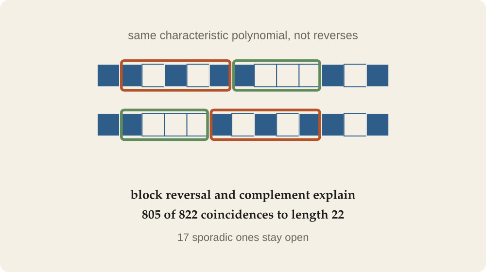</a>

<b><a href="https://github.com/jvvk/mathematics/tree/main/binary-word-polynomials">Binary words with the same polynomial</a></b> 
When do two binary words give tridiagonal matrices with the same characteristic polynomial? One block-reversal lemma, with complementation, explains 805 of the 822 coincidences up to length 22; 17 sporadic ones are left open. 
<a href="https://github.com/jvvk/mathematics/tree/main/binary-word-polynomials/paper">paper</a> · <a href="https://github.com/jvvk/mathematics/tree/main/binary-word-polynomials/lean">Lean</a> · <a href="https://github.com/jvvk/mathematics/tree/main/binary-word-polynomials/verify">code</a> · Lemma and families in Lean; census by computation

</td>
<td width="50%"></td>
</tr>
</table>

### New proofs of known results

<table>
<tr>
<td width="50%" valign="top">

<b><a href="https://github.com/jvvk/mathematics/tree/main/six-circles-rectangle">Six circles in a rectangle</a></b> 
The red segment is exactly as long as the rectangle is tall: a proof by classical geometry alone. 
<a href="https://github.com/jvvk/mathematics/tree/main/six-circles-rectangle/paper">paper</a> · <a href="https://github.com/jvvk/mathematics/tree/main/six-circles-rectangle/lean">Lean</a> · <a href="https://github.com/jvvk/mathematics/tree/main/six-circles-rectangle/verify">code</a> · In Lean, step by step

</td>
<td width="50%"></td>
</tr>
</table>

### Elsewhere

Papers and figures CC BY 4.0, code MIT.
